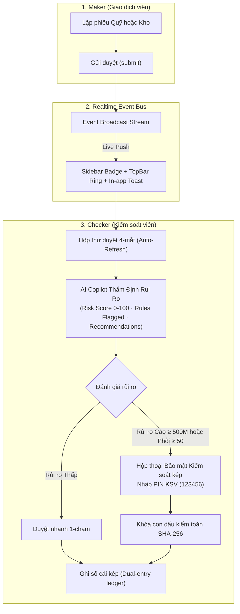

# BankOps — Hệ Thống Vận Hành Kho & Quỹ Ngân Hàng Thông Minh (AI-Powered Core Banking Ops)

[](https://github.com/imtarget05/BankOps/actions/workflows/ci.yml)
[](https://flutter.dev)
[](https://fastapi.tiangolo.com)
[](https://postgresql.org)
[](https://developers.cloudflare.com/workers-ai/)
[](https://github.com/imtarget05/BankOps)

> **Lưu ý an toàn:** Tất cả số tiền, tồn quỹ, giao dịch, mã ấn chỉ và danh tính trong hệ thống là **mô phỏng nghiệp vụ** (`simulation: true`). Không kết nối trực tiếp core banking sản xuất và không sử dụng dữ liệu khách hàng thật.

---

## 1. Điểm Nhấn Kiến Trúc Nâng Cấp (Key Architectural Pillars)



### 1.1. Real-time Dual-Control Notification & Live Sync
- **Đồng bộ sự kiện thời gian thực:** Ngay khi Maker gửi phiếu, Checker nhận thông báo Toast nổi, badge `X CHỜ DUYỆT` trên thanh điều hướng tự động nhảy số.
- **Hộp thư duyệt tự động làm mới:** Tự động reload danh sách phiếu chờ duyệt mà không cần người dùng thao tác F5.

### 1.2. Smart Maker-Checker AI Copilot & Risk Scoring
- **Phân tích rủi ro đa chiều:** Tính toán `risk_score` (0-100), phân loại `LOW` / `MEDIUM` / `HIGH`.
- **Nhận diện vi phạm định mức:** Phát hiện tự động các lệnh rút tiền vượt định mức quầy ($\ge 500$ triệu VND) hoặc xuất ấn chỉ/phôi thẻ số lượng lớn ($\ge 50$ phôi).
- **Kiến nghị hành động & Con dấu kiểm toán:** Đề xuất kiểm đếm thực tế, đối chiếu chứng từ và sinh mã Audit Stamp Hash SHA-256:
  $$\text{Audit Stamp} = \text{SHA256}(\text{request\_id} : \text{maker} : \text{amount} : \text{risk\_score})$$

### 1.3. Dual-Control Security Verification (PIN Supervisor)
- **Cơ chế 4 mắt bắt buộc:** Với các lệnh rủi ro cao, hệ thống yêu cầu nhập mã PIN Kiểm soát viên (`123456`) tại cả Client và Server.
- **Kiểm soát dòng tiền chặt chẽ:** Tự động từ chối nếu số dư két không đủ (`INSUFFICIENT_SIM_CASH`) trước khi cấp quyền ghi sổ.

---

## 2. Hệ Thống Trợ Lý AI & Small LLM Pipeline

1. **Trợ lý Hội thoại BankOps AI (Cloudflare Workers AI)**:
   - Mô hình: `@cf/meta/llama-3.1-8b-instruct`.
   - Cung cấp tư vấn quy trình Maker-Checker, hạn mức két sắt, xử lý lỗi dữ liệu Staging và quy chế kiểm soát nội bộ.
2. **Small LLM Pipeline Cho Máy Không Có GPU & Google Colab T4**:
   - Mô hình nền tảng: `Qwen2.5-1.5B-Instruct` (GGUF Quantized 4-bit `q4_k_m`, tiêu thụ < 1.4 GB RAM trên CPU).
   - Notebook huấn luyện 1-click: [`ai/colab_finetune_bankops_t4.ipynb`](file:///Users/mainguyenbinhtan/Downloads/BankOps/ai/colab_finetune_bankops_t4.ipynb) (Fine-tune ~12 phút trên Colab T4 miễn phí).
   - Tập dữ liệu ngân hàng chuẩn hóa: [`ai/dataset/train.jsonl`](file:///Users/mainguyenbinhtan/Downloads/BankOps/ai/dataset/train.jsonl) (hơn 120 mẫu hội thoại chuẩn hóa quy trình).
   - Máy chủ suy luận CPU độc lập: [`ai/serve_cpu.py`](file:///Users/mainguyenbinhtan/Downloads/BankOps/ai/serve_cpu.py) tương thích OpenAI API và Ollama.

---

## 3. Tài Khoản Demo & Phân Quyền Bảo Mật

Mật khẩu đăng nhập mặc định: **`DemoPass123!`** | Mã PIN Kiểm soát viên: **`123456`**

| Username | Vai trò (Role) | Quyền hạn chính |
| :--- | :--- | :--- |
| **`demo_maker`** | Maker (Giao dịch viên) | Tạo & gửi duyệt phiếu thu/chi quỹ, xuất/nhập kho, import dữ liệu Staging. Tab "Duyệt" bị ẩn hoàn toàn để bảo đảm nguyên tắc kiểm soát kép. |
| **`demo_checker`** | Checker (Kiểm soát viên) | Hộp thư phê duyệt 4-mắt, xem phân tích AI Copilot, duyệt/từ chối phiếu (kèm xác thực PIN với lệnh rủi ro cao), chạy đối soát số liệu. |
| **`demo_auditor`** | Auditor (Kiểm toán nội bộ) | Xem báo cáo tài chính, biến động dòng tiền, lịch sử nhật ký kiểm toán và chuỗi hàm băm toàn vẹn dữ liệu. |

> Hỗ trợ đăng nhập nhanh bằng Google Sign-In SSO: Endpoint `POST /api/v1/auth/google` tự động cấp quyền nhân viên (`staff`) cho tài khoản Google tổ chức.

---

## 4. Khởi Chạy Nhanh Hệ Thống (Docker Compose)

Khởi động toàn bộ cụm dịch vụ (Web UI + FastAPI + Worker + PostgreSQL 16) chỉ với 1 câu lệnh:

```bash
docker compose up -d --build
```

- **Giao diện Web App (Nginx Flutter Web):** [http://localhost:8080](http://localhost:8080)
- **Tài liệu Backend Swagger UI:** [http://localhost:8000/docs](http://localhost:8000/docs)
- **API Health Check:** [http://localhost:8000/health/live](http://localhost:8000/health/live)
- **Cơ sở dữ liệu PostgreSQL:** `localhost:5432` (`bankops` / `bankops`)

---

## 5. Kiểm Thử Chất Lượng & Nghiệm Thu Tự Động

### 5.1. Chạy Kịch Bản Kiểm Chứng E2E Maker-Checker Thực Tế
Chạy script kiểm tra trực tiếp trên cụm Docker API và PostgreSQL thật:
```bash
python3 backend/tests/verify_live_e2e.py
```
*Kết quả:* Tự động thực hiện luồng Maker đăng nhập $\to$ Tạo phiếu 600 triệu $\to$ Gửi duyệt $\to$ Checker xem thẩm định AI (Điểm 88/100, High Risk) $\to$ Thử sai PIN bị từ chối 403 $\to$ Nhập đúng PIN 123456 duyệt thành công $\to$ Xác nhận số dư két sắt tăng chính xác +600,000,000 VND.

### 5.2. Chạy Toàn Bộ Test Suite Backend & Frontend
```bash
# 1. Kiểm tra tĩnh & linter
ruff check backend/ ai/
cd frontend && flutter analyze .

# 2. Chạy unit & widget tests Frontend (14/14 passed)
cd frontend && flutter test --no-pub

# 3. Chạy unit & integration tests Backend (132 passed)
PYTHONPATH=backend python3 -m pytest backend/tests/
```

---

## 6. Cấu Trúc Thư Mục Dự Án

```
BankOps/
├── ai/                          # Small LLM Pipeline (Qwen2.5-1.5B, Colab Notebook, Dataset)
├── backend/                     # FastAPI Backend (Clean Architecture, Async SQLAlchemy)
│   ├── app/api/routes/          # API Routers (auth, cash_sim, inventory, approvals, ai, reports)
│   ├── app/services/            # AI services, ledger, approval controls (PIN validation)
│   └── tests/                   # Test suite (132 tests: E2E, QA acceptance, contracts, AI)
├── frontend/                    # Flutter Web Client (Material 3, Responsive Desktop/Mobile)
│   ├── lib/src/features/        # Các phân hệ (auth, approvals, cash, inventory, reports, ai)
│   └── test/                    # Widget & Unit test suite (14 tests)
├── infra/cloudflare-worker/     # Edge API Gateway (Hono + TypeScript)
├── sample-data/                 # Dữ liệu mẫu ban đầu (users, cashboxes, items, locations)
└── docker-compose.yml           # Cấu hình cụm Docker 4 containers
```
