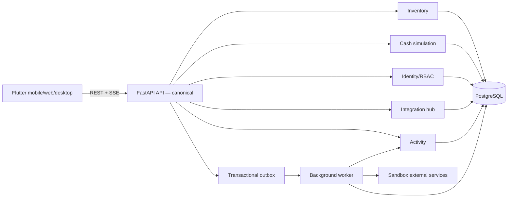
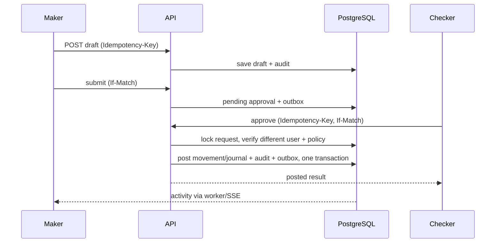

# 03 — Kiến trúc modular monolith

## Quyết định nguồn chuẩn (Phase 0)

**FastAPI + PostgreSQL là API nghiệp vụ chuẩn duy nhất của BankOps.** Mọi lệnh
ghi, phân quyền, maker–checker, audit, outbox và OpenAPI production phải đi qua
FastAPI. Flutter chỉ cấu hình `API_BASE_URL` tới deployment FastAPI đã được
xác nhận cho môi trường tương ứng.

`infra/cloudflare-worker` là implementation cũ/compatibility sandbox, không
được xem là backend đồng sở hữu nghiệp vụ và không có cam kết feature parity
với FastAPI. Không triển khai endpoint hoặc migration nghiệp vụ mới ở Worker.
Nếu còn giữ Worker trong giai đoạn chuyển đổi, nó chỉ được dùng như proxy mỏng
không có state tới FastAPI sau khi có contract, smoke test và rollback plan;
chưa có proxy đó thì Worker không phải đích deploy production.

## Thành phần



## Module boundaries

`identity`, `inventory`, `cash_sim`, `approvals`, `integrations`, `jobs`, `activity`, `audit`, `reporting`, `shared`. Module khác chỉ gọi public service/port; không đọc bảng riêng tùy tiện. `inventory` và `cash_sim` có transaction, approval type và ledger riêng. Reporting đọc view/read model; không ghi vào module nghiệp vụ. Một PostgreSQL cluster và một deployable codebase backend FastAPI; worker nền là process khác dùng cùng package, không phải Cloudflare Worker.

## Layout đề xuất

```text
backend/app/{api,core,modules/{identity,inventory,cash_sim,approvals,integrations,jobs,activity,audit,reporting},db}
backend/alembic/versions
frontend/lib/{app,core/{api,auth,design,router},features/{dashboard,inventory,assets,cash_sim,approvals,integrations,activity}}
infra/{docker,deploy}
tests/{backend,frontend,e2e}
```

## Một command được duyệt



## Failure model

DB transaction atomic cho approval và post. Outbox giữ sự kiện trong cùng transaction; worker at-least-once, consumer idempotent theo event ID. Connector lỗi không rollback nghiệp vụ đã post; hiển thị job failed và retry có kiểm soát. Không distributed transaction với Google.

## Ranh giới deploy và kiểm thử

Một release nghiệp vụ chỉ được chứng minh bằng migration, backend/API tests và
E2E chạy qua FastAPI. Worker typecheck (khi source còn trong repository) chỉ
kiểm tra khả năng build của implementation cũ; không chứng minh parity, RBAC,
transaction semantics hoặc khả năng deploy production. Cloudflare Pages vẫn có
thể host Flutter Web, nhưng không làm Pages/Worker trở thành API nghiệp vụ.
