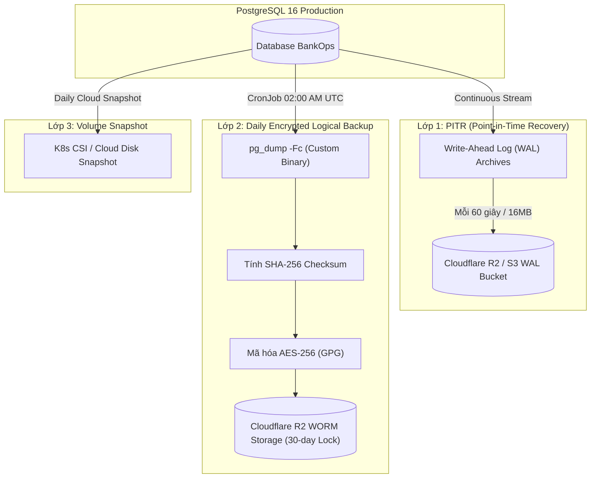

# 20 — Cẩm Nang Sao Lưu Dữ Liệu & Phục Hồi Thảm Họa (Disaster Recovery Runbook)

> **Mục tiêu**: Đảm bảo hệ thống BankOps có khả năng sống sót và phục hồi nguyên vẹn khi xảy ra thảm họa (hỏng phần cứng, lỗi phần mềm, xóa nhầm dữ liệu, hoặc sập toàn bộ Cloud Provider).

---

## 1. Chỉ Số Mục Tiêu An Toàn (SLA & DR Metrics)

| Chỉ số | Định nghĩa | Cam kết mục tiêu BankOps |
| :--- | :--- | :--- |
| **RPO (Recovery Point Objective)** | Lượng dữ liệu tối đa chấp nhận mất mát khi thảm họa xảy ra | **$\le 5$ phút** (Chỉ mất tối đa các thao tác chưa commit trong 5 phút gần nhất) |
| **RTO (Recovery Time Objective)** | Thời gian tối đa để khôi phục hệ thống hoạt động trở lại | **$\le 15$ phút** đối với lỗi dữ liệu;<br/>**$\le 30$ phút** đối với sập toàn bộ cụm Cloud |

---

## 2. Chiến Lược Sao Lưu 3 Lớp (3-Tier Backup Architecture)



1. **Lớp 1 — Continuous WAL Archiving & PITR**:
   - Ghi nhận liên tục từng thay đổi (Write-Ahead Logs) đẩy sang Object Storage.
   - Cho phép phục hồi về thời điểm chính xác đến từng giây (ví dụ: quay lại đúng $14:02:15$ trước khi xảy ra lệnh xóa nhầm).
2. **Lớp 2 — Daily Encrypted Logical Backup (pg_dump + GPG + WORM)**:
   - Tự động chạy lúc 02:00 AM UTC qua K8s CronJob [`cronjob-backup.yaml`](file:///Users/mainguyenbinhtan/Downloads/BankOps/infra/k8s/base/cronjob-backup.yaml).
   - Mã hóa đối xứng AES-256 bằng khóa GPG trước khi đẩy ra khỏi cụm.
   - Áp dụng chính sách **Object Lock (WORM)** trên S3/R2: Ngăn chặn bất kỳ ai (kể cả root) xóa hoặc sửa file backup trong 30 ngày.
3. **Lớp 3 — Storage Volume Snapshot**:
   - Snapshot định kỳ toàn bộ ổ đĩa NVMe của Database để tái tạo nhanh Storage khi cần thiết.

---

## 3. Kịch Bản Khôi Phục Thảm Họa (Incident Playbooks)

### Kịch Bản 1: Pod Backend hoặc Worker Bị Crash (OOM / Bug phần mềm)
- **Cơ chế tự động**: Kubernetes ReplicaSet duy trì 2 Pods cho Backend. Liveness probe `/health/live` tự động phát hiện Pod chết và khởi động Pod mới trong 5–10 giây.
- **Tác động người dùng**: **0 giây gián đoạn**. Lưu lượng được Ingress chuyển hướng sang Pod còn lại.

---

### Kịch Bản 2: Lỗi Bản Cập Nhật Mới Làm Gián Đoạn Nghiệp Vụ (Bad Release)
- **Cách xử lý**:
  ```bash
  # Quay ngược commit trên GitOps repo
  git revert HEAD -m "revert: rollback release to previous stable version"
  git push origin main
  ```
- **Thời gian khôi phục**: **< 30 giây** (ArgoCD tự động kéo Pod về image cũ).

---

### Kịch Bản 3: Thao Tác Nhầm Làm Hỏng Dữ Liệu Hoặc Xóa Bảng (Data Corruption)
- **Tình huống**: Giao dịch viên hoặc Admin vô tình chạy lệnh xóa dữ liệu hoặc migration lỗi.
- **Quy trình xử lý khẩn cấp**:
  1. **Bật chế độ bảo trì (Maintenance Mode)**:
     ```bash
     kubectl scale deployment prod-bankops-api --replicas=0 -n bankops-prod
     ```
  2. **Xác định thời điểm thảm họa**: Ví dụ lỗi xảy ra lúc `2026-10-14 14:15:00 UTC`.
  3. **Khôi phục Database bằng Point-in-Time Recovery (PITR)**:
     - Nếu dùng Cloud SQL / RDS: Sử dụng giao diện Console/CLI chọn *Point in time restore* về `14:14:00 UTC`.
     - Nếu khôi phục từ bản backup hàng ngày:
       ```bash
       bash scripts/dr/restore_postgres.sh /path/to/bankops_dump_latest.dump.gpg bankops
       ```
  4. **Kiểm tra tính toàn vẹn**:
     - Kiểm tra số lượng bảng: `SELECT count(*) FROM information_schema.tables WHERE table_schema='public';`
     - Kiểm tra phiên bản migration: `SELECT version_num FROM alembic_version;`
  5. **Mở lại hệ thống**:
     ```bash
     kubectl scale deployment prod-bankops-api --replicas=2 -n bankops-prod
     ```
- **Thời gian khôi phục**: **10 - 15 phút**.

---

### Kịch Bản 4: Toàn Bộ Kubernetes Cluster Hoặc Cloud Provider Gặp Sự Cố (Complete Cloud Disaster)
- **Tình huống**: Cụm GKE/EKS bị xóa nhầm, hoặc Data Center tại vùng gặp sự cố thảm họa diện rộng.
- **Quy trình tái thiết lập từ con số 0 (Cold Disaster Recovery)**:
  1. **Khởi tạo cụm Kubernetes mới** tại Region/Provider dự phòng (sử dụng Terraform/OpenTofu hoặc tạo thủ công trong 5 phút).
  2. **Cài đặt ArgoCD vào cụm mới**:
     ```bash
     kubectl create namespace argocd
     kubectl apply -n argocd -f https://raw.githubusercontent.com/argoproj/argo-cd/stable/manifests/install.yaml
     ```
  3. **Khôi phục toàn bộ cấu hình ứng dụng từ Git**:
     ```bash
     kubectl apply -f infra/argocd/appproject.yaml
     kubectl apply -f infra/argocd/bankops-application.yaml
     ```
     ArgoCD sẽ tự động kéo toàn bộ Deployment, Service, Ingress, CronJob về cụm mới trong 2 phút!
  4. **Khôi phục dữ liệu Database từ Cloud Storage (R2 / S3)**:
     ```bash
     # Tải bản backup mới nhất từ S3
     aws s3 cp s3://bankops-backups/postgres/latest/bankops_dump.dump.gpg /tmp/backup.dump.gpg
     
     # Chạy script restore
     bash scripts/dr/restore_postgres.sh /tmp/backup.dump.gpg bankops
     ```
  5. **Cập nhật DNS**:
     - Đổi bản ghi DNS trên Cloudflare trỏ địa chỉ IP Ingress sang Load Balancer của cụm mới.
- **Thời gian khôi phục toàn bộ**: **< 30 phút**.

---

## 4. Quy Trình Diễn Tập Thảm Họa Định Kỳ (DR Drill Procedure)

Để đảm bảo các bản backup không bao giờ bị rỗng, hỏng hoặc không thể giải mã:
- **Tần suất**: Tự động chạy định kỳ hằng tháng.
- **Lệnh thực hiện diễn tập tự động**:
  ```bash
  bash scripts/dr/dr_drill_test.sh
  ```
- **Các bước script tự động kiểm tra**:
  1. Dump cơ sở dữ liệu hiện tại.
  2. Tạo mã băm SHA-256.
  3. Mã hóa bằng GPG AES-256.
  4. Khởi tạo một database thử nghiệm tạm thời.
  5. Giải mã và nạp dữ liệu vào database thử nghiệm.
  6. So sánh đối soát số lượng bảng và phiên bản alembic.
  7. Báo cáo kết quả và tự dọn dẹp môi trường thử nghiệm.
