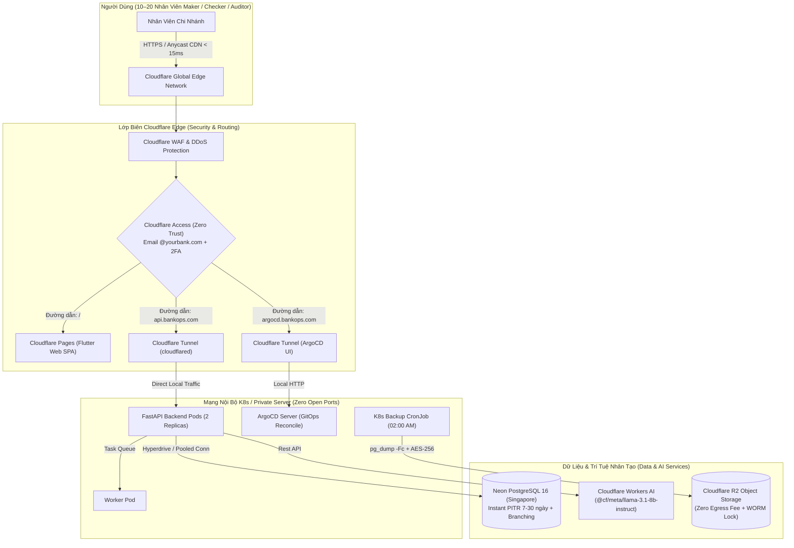

# 21 — Toàn Bộ Hạ Tầng BankOps Trên Hệ Sinh Thái Cloudflare (10–20 Users)

> **Mục tiêu**: Tối ưu hóa toàn diện hệ thống BankOps để vận hành trên hệ sinh thái Cloudflare. Đạt chuẩn bảo mật **Zero Trust (ZTNA)** của ngành ngân hàng, tối ưu chi phí xuống mức thấp nhất (~$15 – $30/tháng cho 10–20 người dùng) và loại bỏ hoàn toàn việc mở cổng công khai (No Open Inbound Ports).

---

## 1. Sơ Đồ Kiến Trúc Cloudflare Toàn Diện (Cloudflare-Native Architecture)



---

## 2. Các Cấu Phần Cloudflare Được Tích Hợp

| Dịch vụ Cloudflare | Vai trò trong BankOps | Gói chi phí cho 10–20 Users |
| :--- | :--- | :--- |
| **Cloudflare Pages** | Host ứng dụng Flutter Web tĩnh, phân phối qua Anycast CDN toàn cầu với hơn 300 trung tâm dữ liệu (Hà Nội, TP.HCM, Singapore). | **Miễn phí 100%** (Free tier không giới hạn requests và bandwidth) |
| **Cloudflare Tunnel (`cloudflared`)** | Tạo đường hầm mã hóa bảo mật từ Kubernetes Cluster về Edge. **Không cần mở cổng Firewall, không cần mua Public IP tĩnh**. | **Miễn phí 100%** |
| **Cloudflare Access (Zero Trust)** | Cổng đăng nhập bảo mật cho nhân viên ngân hàng: Tích hợp Google Workspace / Microsoft Entra ID hoặc mã PIN OTP gửi về email. | **Miễn phí 100%** (Gói Zero Trust miễn phí tối đa tới 50 người dùng) |
| **Cloudflare R2** | Lưu trữ các bản sao lưu Database hàng ngày (`pg_dump -Fc` nén mã hóa). **Không tính phí tải về (Zero Egress Fee)** khi khôi phục thảm họa. | **Miễn phí 10GB đầu tiên**, sau đó chỉ $0.015/GB/tháng |
| **Cloudflare Workers AI** | Cung cấp LLM inference trực tiếp tại Edge phục vụ AI Copilot thẩm định rủi ro giao dịch (Maker-Checker). | **Miễn phí 10,000 neurons/ngày** (đủ cho 10-20 users), vượt định mức tính theo usage cực rẻ |
| **Compute K8s (VPS Backend)** | Chạy FastAPI, Worker và ArgoCD (1 VPS 4 vCPU / 8GB RAM). | **~$15 - $25 / tháng** |
| **PostgreSQL (Neon Serverless)** | Cơ sở dữ liệu nghiệp vụ chuẩn ACID với PITR và autoscaling. | **~$0 - $19 / tháng** |
| **TỔNG CHI PHÍ HẰNG THÁNG** | - | **Chỉ ~$15 - $35 / THÁNG** |

---

## 3. Hướng Dẫn Từng Bước Thiết Lập

### Bước 1: Tạo Cloudflare Tunnel Cho Backend & ArgoCD

1. Cài đặt `cloudflared` hoặc vào giao diện **Cloudflare Zero Trust Dashboard** $\rightarrow$ **Networks** $\rightarrow$ **Tunnels** $\rightarrow$ **Create a Tunnel**.
2. Đặt tên: `bankops-prod-tunnel`.
3. Copy **Tunnel Token** và nạp vào Secret Kubernetes:
   ```bash
   kubectl create secret generic bankops-secrets \
     --from-literal=CLOUDFLARE_TUNNEL_TOKEN="<YOUR_TUNNEL_TOKEN>" \
     -n bankops-prod
   ```
4. Cấu hình **Public Hostnames** trên Cloudflare Dashboard:
   - `api.bankops.yourbank.com` $\rightarrow$ Service Type: `HTTP`, URL: `bankops-api:8000`
   - `argocd.bankops.yourbank.com` $\rightarrow$ Service Type: `HTTP`, URL: `argocd-server.argocd.svc:80`
5. Áp dụng Deployment Cloudflare Tunnel vào cụm:
   ```bash
   kubectl apply -f infra/k8s/base/cloudflare-tunnel.yaml -n bankops-prod
   ```
   Hai Pods `cloudflare-tunnel` sẽ kết nối ra Cloudflare Edge. Lúc này toàn bộ API và ArgoCD đã được truy cập an toàn mà **không cần mở bất kỳ cổng nào** trên máy chủ!

---

### Bước 2: Thiết Lập Cloudflare Pages Cho Giao Diện Web

1. Vào **Cloudflare Dashboard** $\rightarrow$ **Workers & Pages** $\rightarrow$ **Create application** $\rightarrow$ **Pages**.
2. Kết nối với GitHub Repository `imtarget05/BankOps`.
3. Cấu hình Build Settings:
   - **Framework preset**: `None`
   - **Build command**: `flutter build web --release --dart-define=API_BASE_URL=https://api.bankops.yourbank.com`
   - **Build output directory**: `frontend/build/web`
4. Copy 2 file cấu hình có sẵn trong repo:
   - [`infra/cloudflare-pages/_headers`](file:///Users/mainguyenbinhtan/Downloads/BankOps/infra/cloudflare-pages/_headers): Thiết lập Security Headers và Cache cho Flutter Web.
   - [`infra/cloudflare-pages/_redirects`](file:///Users/mainguyenbinhtan/Downloads/BankOps/infra/cloudflare-pages/_redirects): Cấu hình SPA routing về `index.html`.

---

### Bước 3: Tạo Bucket Cloudflare R2 Để Lưu Trữ Bản Sao Lưu

1. Vào **Cloudflare Dashboard** $\rightarrow$ **R2** $\rightarrow$ **Create Bucket** $\rightarrow$ đặt tên `bankops-backups`.
2. Tạo API Token cho R2:
   - Permissions: `Object Read & Write`
   - Lấy `Access Key ID`, `Secret Access Key` và Endpoint:
     `https://<account_id>.r2.cloudflarestorage.com`
3. Nạp thông tin vào [`infra/k8s/base/configmap.yaml`](file:///Users/mainguyenbinhtan/Downloads/BankOps/infra/k8s/base/configmap.yaml):
   ```yaml
   S3_BUCKET: "bankops-backups"
   S3_ENDPOINT: "https://<account_id>.r2.cloudflarestorage.com"
   ```
4. K8s CronJob sao lưu hàng ngày [`infra/k8s/base/cronjob-backup.yaml`](file:///Users/mainguyenbinhtan/Downloads/BankOps/infra/k8s/base/cronjob-backup.yaml) sẽ tự động đẩy các bản dump mã hóa AES-256 lên R2.

---

### Bước 4: Thiết Lập Cloudflare Access (Zero Trust) Bảo Vệ Ngân Hàng

1. Vào **Zero Trust Dashboard** $\rightarrow$ **Access** $\rightarrow$ **Applications** $\rightarrow$ **Add an application**.
2. Thêm chính sách bảo vệ cho:
   - `argocd.bankops.yourbank.com` (Bảng điều khiển triển khai GitOps)
   - `bankops.yourbank.com` (Trang nhân viên nội bộ)
3. Cấu hình Rules (Quy tắc truy cập):
   - **Include**: Emails ending in `@yourbank.com` (hoặc danh sách 10–20 email nhân viên cụ thể).
   - **Authentication**: Gửi mã One-Time PIN (OTP) 6 số về email nhân viên hoặc tích hợp SSO Google/Microsoft.
4. **Kết quả**: Bất kỳ ai ngoài Internet không có email nội bộ ngân hàng sẽ bị chặn ngay tại lớp mạng của Cloudflare trước khi chạm tới hệ thống.

---

## 4. Kịch Bản Phục Hồi Thảm Họa (Disaster Recovery) Với Cloudflare

| Tình huống sự cố | Cách xử lý với Cloudflare | Thời gian phục hồi (RTO) |
| :--- | :--- | :--- |
| **Máy chủ K8s / VPS bị chết hoàn toàn** | 1. Bật máy chủ mới ở bất kỳ đâu.<br/>2. Chạy `cloudflared tunnel run --token <TOKEN>`.<br/>3. Cloudflare tự động chuyển toàn bộ traffic sang máy chủ mới ngay lập tức mà không cần đổi DNS! | **< 5 phút** |
| **Phục hồi dữ liệu từ bản sao lưu R2** | Tải bản dump từ Cloudflare R2 về khôi phục (`scripts/dr/restore_postgres.sh`). Không bị giới hạn băng thông, **0 đồng phí egress**. | **< 10 phút** |
| **Tấn công từ chối dịch vụ (DDoS) / Brute force** | Cloudflare WAF tự động hấp thụ toàn bộ lưu lượng tấn công tại 300+ PoP trên thế giới, bảo vệ backend không bị nghẽn. | **Tự động (0 giây)** |
