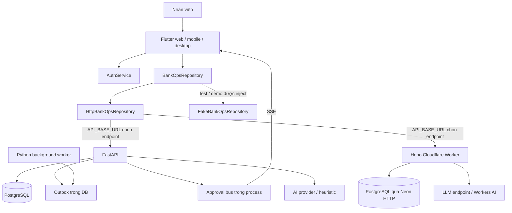

# 01 — Bản đồ codebase và khoảng trống

## 1. Hệ thống hiện tại

Đây là hai implementation API độc lập, không phải Worker tự động proxy FastAPI. Hai hình DB thể hiện cấu hình đường kết nối; chưa kiểm chứng chúng có trỏ cùng database trong deployment hay không.

| Khu vực | Điểm vào và trách nhiệm | Nhận xét |
|---|---|---|
| Flutter bootstrap | `frontend/lib/main.dart`, `src/features/auth/auth_service.dart` | Provider cho auth/theme; AuthGate chọn login hoặc AppShell |
| Điều hướng | `frontend/lib/src/app/app_shell.dart` | 9 mục, sidebar/rail/bottom navigation; chọn màn bằng index |
| Dữ liệu UI | `frontend/lib/src/data/models/`, `data/repositories/` | DTO viết tay; HTTP và fake cùng interface |
| API Python | `backend/app/main.py`, `api/routes/` | Mount route gốc và alias `/api/v1`; phần lớn logic nghiệp vụ nằm trong route |
| Persistence | `backend/app/models/`, `database.py`, `alembic/` | SQLAlchemy async; Decimal cho cột tiền/lượng, read model số dư riêng |
| Nền | `backend/app/worker.py`, `services/approval_events.py` | Worker và SSE bus là hai cơ chế khác nhau |
| API edge | `infra/cloudflare-worker/src/index.ts`, `routes/`, `db/client.ts` | Hono, JWT, SQL trực tiếp; còn nhiều placeholder |
| AI | `backend/app/services/ai.py`, Worker `routes/ai.ts`, `ai/`, `infra/modal/`, `infra/hf-llm-space/` | Heuristic + LLM tư vấn; nhiều lựa chọn phục vụ mô hình |
| Chất lượng | `backend/tests/`, `frontend/test/`, `.github/workflows/ci.yml`, `Makefile` | Có unit/integration/widget/contract; kết quả lịch sử chưa phải kết quả hiện tại |
| Triển khai | `docker-compose.yml`, `infra/cloudflare-pages/`, `frontend/dist/` | Compose phục vụ web build có sẵn; cần kiểm soát sự khớp giữa source và artifact |

## 2. Tính năng theo góc nhìn nhân viên

| Phân hệ | Đã có trong code | Khoảng trống quan trọng |
|---|---|---|
| Đăng nhập/hồ sơ | Password, Google, token, đổi password/PIN, OTP, sửa hồ sơ | Enrollment nhân viên, phân công đơn vị, session bền, chặn đường demo ngoài demo |
| Tổng quan | Dashboard, badge chờ duyệt, tìm kiếm | Việc theo người/phạm vi/SLA; số liệu không bị giới hạn ngầm ở trang đầu |
| Kho | SKU, location, balance, asset serial, receipt/issue/transfer/adjustment API | Form tạo hiện chỉ nhập/xuất một dòng; vòng đời serial, kiểm kê, phân quyền danh mục |
| Quỹ mô phỏng | Cashbox, receipt/payment, journal kép, balance | Ca làm việc, bàn giao, bảng kê lưu có cấu trúc, đảo phiếu cần duyệt |
| Phê duyệt | Inbox, duyệt/từ chối, bulk, PIN, AI assessment | Snapshot đầy đủ/version, quyền theo phạm vi, reject reason riêng, lịch sử quyết định nhất quán |
| Nhập dữ liệu | Python CSV/JSON/Sheets staging, confirm tạo draft nhập kho, webhook HMAC | Worker chưa tương đương; XLSX chưa thấy parser/UI import; pagination staging |
| Đối soát | Python journal debit/credit và movement/balance, màn kết quả | So số dư quỹ với ledger, xử lý exception tới đóng, snapshot nhất quán |
| Báo cáo | Ngày/tháng kho/quỹ, tồn đọng, tiện ích export | Business date, scope, định nghĩa số liệu, export snapshot/audit phía server |
| Hoạt động | Outbox feed, SSE, request timeline | Phân quyền sự kiện, replay bền, worker dispatch thật |
| Quản trị | Seed role/capability, màn cài đặt cá nhân | Chưa có module quản trị nhân sự/quyền/đơn vị đầy đủ |

## 3. Các đường gọi cần biết

### Tạo và duyệt phiếu

`RequestsScreen` → `createStockRequest/createCashRequest` → `HttpBankOpsRepository` → route tạo draft → submit → `ApprovalsScreen` → route approve → movement/journal + balance.

Python dùng `draft → submitted → posted|rejected`; Flutter ánh xạ `submitted` thành `RequestStatus.pending`. Tài liệu cũ dùng `pending` cho API là chưa khớp. Không đổi tên trạng thái wire một cách âm thầm.

PIN là bước xác thực tăng cường của checker; PIN không tạo thêm một người phê duyệt thứ ba. “4 mắt” đến từ maker và checker khác user ID.

### Nhập dữ liệu

`ImportScreen` → upload CSV/JSON hoặc fetch Sheet → `_stage_run` → preview → `confirm_run` → draft receipt nhóm theo location → maker submit → checker approve. Hiện confirm không tạo phiếu quỹ. File picker chỉ chấp nhận CSV/JSON.

### Thông báo

Python submit/approve/reject gọi broadcast sau commit tới bus trong process. HTTP repository đọc từng dòng `data:`. Shell/approval screen tải lại inbox khi nhận event. Worker SSE chỉ gửi connected/ping nên không thể coi đó là thông báo thay đổi nghiệp vụ thực sự.

### Đối soát

Python chạy trực tiếp trong request HTTP, lưu run và exceptions; worker chưa thực thi công việc đối soát. Worker API edge trả `matched` mà chưa so ledger. Kết quả “khớp” của hai deployment không có cùng ý nghĩa.

## 4. Phát hiện có bằng chứng

Mức ưu tiên dưới đây do người khảo sát đánh giá từ nguồn. Jev không trả kết quả vì gateway không kết nối được; không có điểm xác suất được sử dụng. Chưa tái hiện tấn công trên dịch vụ đang chạy.

| ID | Mức | Bằng chứng nguồn | Tác động và yêu cầu sửa |
|---|---|---|---|
| F01 | P0 | [auth.py](../../backend/app/api/routes/auth.py), `forgot_password` trả `otp_demo` vô điều kiện | OTP bị cung cấp ngay cho bên yêu cầu; response ngoài demo không được chứa OTP, bổ sung chống dò và thu hồi phiên |
| F02 | P0 | [auth.py](../../backend/app/api/routes/auth.py), `google_login` nhận `mock-` không kiểm tra môi trường; [auth_google.py](../../backend/app/api/routes/auth_google.py) cũng khai báo `/google`; `main.py` mount cả hai | Gộp một handler và chỉ cho mock qua dependency test; test router công khai thực tế, không chỉ gọi helper |
| F03 | P0 | [docker-compose.yml](../../docker-compose.yml), cấu hình SMTP có password fallback literal | Bỏ giá trị bí mật khỏi cấu hình; xác định chủ sở hữu để thay/revoke credential nếu từng dùng. Không sao chép giá trị vào tài liệu/log |
| F04 | P0 | [activity.py](../../backend/app/api/routes/activity.py), `events_stream` thiếu dependency xác thực; các snapshot đọc toàn bộ outbox | Bảo vệ stream và lọc từng event theo phạm vi; authentication của alias khác không bảo vệ route này |
| F05 | P0 | [inventory.py](../../backend/app/api/routes/inventory.py) dùng `_VIEW_CATALOG` cho POST/PUT/DELETE danh mục; `delete_request` không kiểm maker | Người chỉ xem tồn có thể đạt dependency ghi; xóa draft người khác chưa bị kiểm ownership |
| F06 | P0 | [cash_sim.py](../../backend/app/api/routes/cash_sim.py), CRUD cashbox/delete draft chỉ `get_current_user`; list requests không lọc owner | Phải có capability riêng và object scope; auditor không được thay đổi dữ liệu |
| F07 | P0 | [cash_sim.py](../../backend/app/api/routes/cash_sim.py), `reverse_cash_request` tạo request `posted` và journal ngay; [cash_sim model](../../backend/app/models/cash_sim.py) không unique `reversal_of` | Đảo phiếu bỏ qua lượt duyệt mới; cần chống đảo lại và một reversal request riêng |
| F08 | P0 | [idempotency.py](../../backend/app/services/idempotency.py) `_store` theo key toàn process, remember sau commit; cash approve không replay key | Mất kết quả sau restart/qua replica; collision giữa actor/route; lưu key/payload/result cùng transaction |
| F09 | P0 | [cash_sim.py](../../backend/app/api/routes/cash_sim.py) `_balance_for_box`; [inventory.py](../../backend/app/api/routes/inventory.py) `_get_balance` không lock số dư | Lock request không bảo vệ hai phiếu khác nhau dùng cùng balance. Cần test concurrent khác request, số dư không mất cập nhật |
| F10 | P0 | Worker [cash-sim.ts](../../infra/cloudflare-worker/src/routes/cash-sim.ts), [inventory.ts](../../infra/cloudflare-worker/src/routes/inventory.ts), [db/client.ts](../../infra/cloudflare-worker/src/db/client.ts) | Posting gồm nhiều SQL riêng không transaction bao trùm; lỗi giữa chừng có thể để lại trạng thái/ledger dở dang; thiếu kiểm tra quyền ở create/submit/reject |
| F11 | P0 | [database.py](../../backend/app/database.py), `init_db` reset một cash balance về 0 khi không production; [seed.py](../../backend/app/seed.py) tạo opening balance trực tiếp | Restart có thể thay read model mà ledger không đổi; opening phải có nguồn sổ hoặc baseline được mô hình hóa |
| F12 | P0 | [reconciliations.py](../../backend/app/api/routes/reconciliations.py) cash chỉ so dr/cr; Worker [reconciliations.ts](../../infra/cloudflare-worker/src/routes/reconciliations.ts) ghi `recon_runs`, trả `matched` cả khi DB lỗi | “Cân journal” không đồng nghĩa “đúng số dư”; bảng ORM tên `reconciliation_runs`; không được trả thành công giả |
| F13 | P1 | [approval_controls.py](../../backend/app/services/approval_controls.py) hỗ trợ `user.pin_hash`, nhưng call site kho/quỹ không truyền `user` | PIN cá nhân vừa đổi có thể không được dùng ở endpoint duyệt; rate limit rơi về key global. Unit helper pass chưa đủ |
| F14 | P1 | [auth_utils.py](../../backend/app/api/routes/auth_utils.py) `get_current_user` không kiểm status; revocation/rate limit/OTP trong memory; Flutter AuthService chưa refresh tự động | Khóa tài khoản/đăng xuất phải có hiệu lực xuyên process; hết token giữa ca cần xử lý rõ |
| F15 | P1 | [worker.py](../../backend/app/worker.py) job executor placeholder, claim không row lock, outbox chỉ đánh dấu published | Chưa có bảo đảm dispatch/retry thực; model Job thiếu lease/retry/heartbeat mà code kiểm bằng `hasattr` |
| F16 | P1 | [inventory.py](../../backend/app/api/routes/inventory.py) `_validate_transition` chưa được gọi, lines rỗng được chấp nhận, target thiếu có thể `continue` | Validate tại submit/approve: ít nhất một dòng, location hợp lệ, nguồn khác đích, item active, serial đúng |
| F17 | P1 | Routes kho/quỹ reject cho reason tùy chọn và ghi đè `req.reason`; cash approve không tạo `ApprovalDecision` | Mất diễn giải maker và thiếu lịch sử quyết định đồng nhất; reason rejection phải lưu riêng |
| F18 | P1 | API Python có `cursor` nhưng nhiều list không áp điều kiện từ cursor; HTTP repository chỉ đọc một trang | Quá 100 bản ghi có thể thiếu kết quả và sai KPI; pagination cần contract end-to-end |
| F19 | P1 | [http_bankops_repository.dart](../../frontend/lib/src/data/repositories/http_bankops_repository.dart) đọc `approved_by`, movement `created_at`, trong khi Python trả `approver_id`, `posted_at` | Timeline/approver bị mất hoặc thời gian mặc định thành hiện tại; cần DTO contract chung |
| F20 | P1 | Repository gửi structured inventory kind `issue/receipt` tới `/ai/assess-request`, Python input chỉ nhận `cash/inventory/quỹ/kho` | Có thể 422 rồi rơi về heuristic client; tách `domain` và `kind`, dùng dữ liệu từ DB |
| F21 | P1 | Repository `_idemKey()` mới mỗi lần gọi, không gửi `If-Match`; SSE token đặt query URL | Retry không đại diện cùng một command; thiếu bảo vệ stale UI; không đưa token vào URL/log |
| F22 | P1 | `AuthService.updateProfile` catch mạng rồi cập nhật local/trả true; `AppUser` có fallback phone/branch demo | Có thể báo lưu thành công khi server chưa lưu; thông tin giả phải chỉ ở demo, scope không lấy từ profile text |
| F23 | P1 | Worker [integrations.ts](../../infra/cloudflare-worker/src/routes/integrations.ts) test luôn true, Sheets trả row mẫu, confirm trả draft list rỗng | UI thành công không chứng minh dữ liệu đã nhập; triển khai thật hoặc trả unsupported/failed rõ ràng |
| F24 | P1 | [integrations.py](../../backend/app/api/routes/integrations.py) commit từng row staging; dedupe dùng truy vấn trước insert; confirm không lock run | Có thể staging một phần hoặc tạo draft trùng khi chạy cạnh tranh; cần unique/transaction và job status đúng |
| F25 | P1 | `HttpBankOpsRepository.testConnection` không gửi key, API Python `_require_key` | Nút test connector có thể nhận 400; bổ sung contract test bằng HTTP repository thật |
| F26 | P1 | [requests_screen.dart](../../frontend/lib/src/features/requests/requests_screen.dart) bảng kê chỉ cập nhật amount/reason; model CashRequest chưa có denomination lines | Bảng kê không là chứng từ kiểm đếm có thể đối chiếu server; sửa amount sau kê có thể không còn khớp |
| F27 | P1 | [reports_screen.dart](../../frontend/lib/src/features/reports/reports_screen.dart) `Future.wait` gộp reports với reconciliation; seed staff thiếu `_RECON_CAPS` | Một 403 đối soát có thể làm hỏng toàn màn báo cáo của maker; tải theo quyền và tách trạng thái từng tab |

## 5. Khác biệt hai API cần đóng trước đổi deployment

| Hợp đồng | FastAPI | Worker hiện tại |
|---|---|---|
| Draft kho/quỹ | Có capability ở create; cash delete còn thiếu scope | Create/submit chưa kiểm quyền đầy đủ |
| Approve | ORM session, invariant khác maker, còn vấn đề balance lock | SQL tách rời; quyền approve có nhưng atomicity chưa có |
| Reject | Kiểm capability; reason vẫn chưa bắt buộc | Thiếu capability reject và không lưu reason |
| Catalog CRUD | Có | Route đã khảo sát chủ yếu read và request workflow |
| Realtime | Broadcast trong process | Connected/ping |
| Import | CSV/JSON và Sheets staging thật trong Python | Placeholder/thiếu upload-preview tương ứng |
| Đối soát | Thực hiện một phần phép so | Trả matched placeholder |
| Auth/session | Revocation memory | Logout chỉ response; nhiều handler riêng gọi verifyToken |
| Error | AppError envelope, một số HTTPException mất mã nghiệp vụ | Trộn `detail` và `error` |

## 6. Giới hạn chất lượng hiện tại

`backend/tests/test_approval_controls.py` đã chạy: **7 passed**. Đây là kiểm thử helper, không có chứng cứ rằng tài khoản vừa đổi PIN có thể duyệt qua endpoint thật. Các test trong `test_change_security.py` phụ thuộc DB và có thay đổi tài khoản; không chạy chúng vào DB đang dùng để khảo sát.

Các bộ acceptance, contract, SSE, AI và widget đã được nhận diện trong repo. Những số “136 passed”, “28 passed”, “Quality Gate Passed” trong README là thông tin cũ, không được dùng làm chứng nhận cho working tree hiện tại. Cần PostgreSQL test riêng, migration thật và test qua HTTP cho cả tuyến được chọn triển khai.

Các khẳng định chi phí, tốc độ hay gói miễn phí trong tài liệu AI/hosting chưa được kiểm chứng trong khảo sát này; không dùng làm cơ sở dự toán hay lựa chọn triển khai.
