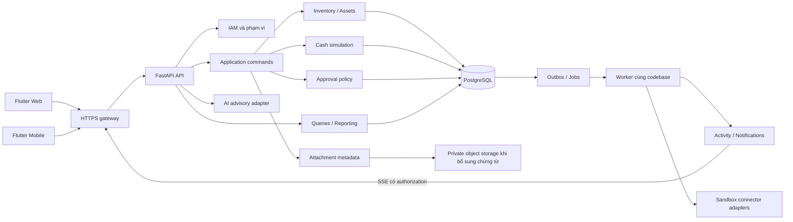
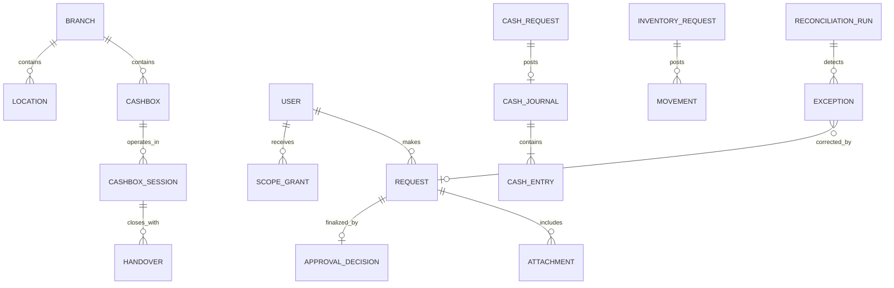

# 02 — Kiến trúc đích cho web/app nhân viên

Trạng thái: **đề xuất**, chưa triển khai. Giữ Flutter và FastAPI hiện hữu; ưu tiên tính đúng nghiệp vụ trước mở rộng hạ tầng.

## 1. Quyết định kiến trúc

| ADR | Đề xuất | Lý do và đánh đổi |
|---|---|---|
| A01 | FastAPI là backend nghiệp vụ chuẩn; Worker làm gateway/proxy hoặc bỏ khỏi đường nghiệp vụ | Tránh hai implementation drift. Đổi lại cần vận hành Python API; chưa chuyển traffic đến khi parity test đạt |
| A02 | Modular monolith, một PostgreSQL cho giao dịch cốt lõi; worker process dùng cùng domain service | Có thể bảo đảm ledger/balance/audit cùng transaction, chưa cần microservice |
| A03 | API chỉ parse/auth/serialize; application service quản lý transaction, policy và nghiệp vụ | Refactor từng luồng; tránh rewrite đồng loạt và tránh service gọi route |
| A04 | Role → capabilities; authorization kết hợp user + scope + action + resource | Quyền theo đơn vị/kho/két; role label của Flutter không phải nguồn quyền |
| A05 | Ledger/movement là nguồn sự thật; balance là projection giao dịch | Opening balance cũng phải truy vết; không reset projection khi khởi động |
| A06 | REST xác nhận trạng thái; SSE chỉ thông báo cần đồng bộ | Mất kết nối không được tạo phiếu/duyệt trùng; có thể fallback polling |
| A07 | AI tư vấn, policy tất định quyết định điều kiện duyệt | Mô hình lỗi không ngăn xem xét thủ công; AI không có quyền ghi ledger |
| A08 | Không offline submit/approve trong pilot | Giữ form chưa gửi; trạng thái server chưa biết phải hiển thị “đang xác minh”, không “thành công” |

## 2. Topology đề xuất



Chỉ API/worker có quyền ghi DB nghiệp vụ. Gateway không có đường SQL posting riêng. AI nhận dữ liệu tối thiểu đã lọc theo quyền. Object storage là phần bổ sung khi có attachment; chưa bắt buộc để sửa những P0 hiện tại.

## 3. Ranh giới module

| Module | Sở hữu | Command/query chính |
|---|---|---|
| Identity & organization | Employee profile, organization/branch, role grant, scope grant, session | current user, grant/revoke, lock user, refresh/revoke session |
| Inventory | Item/location, request/lines, movement/balance | create/edit/submit/approve/reject/cancel, stocktake adjustment |
| Assets | Serial, custody, handover history | register, assign, return, transfer, retire |
| Cash simulation | Cashbox, cash request, denomination, journal/entry/balance | receipt/payment, approved reversal, opening journal |
| Approvals | Policy version, decision, request snapshot hash | evaluate eligibility, approve/reject; không tự tính ledger |
| Reconciliation | Run, snapshot, exception, resolution | compare, assign, investigate, link adjustment, verify close |
| Integrations | Connector config/secret reference, mapping, staging/run | validate, stage, confirm draft, retry |
| Activity & audit | Outbox, notification, immutable audit | publish, replay, mark read, audit query |
| Reporting | Read queries và export snapshot | daily/monthly, stock/cash ledger, ageing, export |
| Shift operations | Business day, cashbox session, handover | open, count, submit handover, accept, close |

Không xây workflow engine tổng quát ở pilot. Inventory và cash giữ aggregate riêng, dùng chung cơ chế authorization/idempotency/audit. Một thao tác approve gọi module sở hữu phiếu để post; không có bảng “giao dịch chung” thay thế mọi model.

Layout tiến hóa từ code hiện tại:

```text
backend/app/
  api/routes/                 # HTTP adapters giữ URL tương thích
  modules/
    inventory/{commands,queries,policy}.py
    cash_sim/{commands,queries,posting,policy}.py
    approvals/{service,policy}.py
    identity/{authorization,sessions}.py
    reconciliation/{service,queries}.py
    integrations/{service,adapters}/
  services/                   # adapters dùng chung trong giai đoạn chuyển đổi
  models/                     # giữ mapping hiện tại trước khi cần di chuyển
  worker.py                   # gọi handler registry, không placeholder
```

Di chuyển từng command cùng test; route cũ ủy quyền tới service. Không đồng thời đổi URL, schema, tên bảng và layout trong một bước.

## 4. Transaction và chống ghi trùng

### Hợp đồng một command

Mọi mutation có `Idempotency-Key`. Lệnh tác động phiếu hiện hữu có `If-Match` khớp version. Key thuộc **một ý định thao tác**; client giữ cùng key khi retry vì timeout và sinh key mới chỉ khi nội dung/ý định mới.

```mermaid
sequenceDiagram
  participant C as Checker
  participant A as API + command service
  participant D as PostgreSQL
  participant W as Worker
  C->>A: approve(id, version, idempotency key, step-up)
  A->>A: authenticate + capability + resource scope
  A->>D: BEGIN; reserve scoped idempotency key
  A->>D: lock request + re-read submitted/version
  A->>D: lock affected balances in stable order
  A->>A: maker != checker; validate policy + funds/stock
  A->>D: decision + ledger/movement + balance + audit + outbox + result
  A->>D: COMMIT
  A-->>C: canonical posted result + new version
  W->>D: claim committed outbox
  W-->>C: authorized notification; client refreshes REST
```

Chi tiết:

1. Kiểm quyền hiện tại trước khi trả replay, tránh key cũ trở thành đường truy cập ngoài scope.
2. Idempotency unique `(actor_id, operation, key)`; operation chứa route chuẩn và resource ID. Lưu canonical payload hash, status, response body, created/expires, request ID. Không lưu PIN/OTP vào request body audit hoặc idempotency record.
3. Với approve, hash dùng subject/version/decision. Step-up được kiểm cho command mới; replay của cùng actor trả kết quả đã commit mà không thực thi lại. Sau đổi nội dung/version là command mới.
4. Reserve key và ghi result trong cùng DB transaction. Unique contention: đợi transaction cạnh tranh kết thúc trong giới hạn timeout, đọc lại result; cùng hash → replay; khác hash → 409. Không đánh dấu thành công nếu transaction rollback.
5. Lock request rồi balance theo thứ tự ổn định `(location_id,item_id)` hoặc `cashbox_id`; tạo balance vắng bằng upsert an toàn trước lock. Lock request riêng không đủ cho hai phiếu cùng két/kho.
6. Kiểm trạng thái/version sau lock; thiếu `If-Match` → 428; malformed → 422; stale → 409. Lưu version mới cùng kết quả.
7. Posting, approval decision, audit, outbox và balance cùng commit; lỗi ở bất kỳ bước nào rollback toàn bộ. Unique journal/request và unique movement/request-line-location là lớp bảo vệ cuối.
8. HTTP timeout sau commit: client query trạng thái command/phiếu hoặc retry cùng key, không tạo key mới. UI hiển thị “Chưa xác nhận kết quả — đang kiểm tra”.

Các endpoint hiện đang bỏ qua key/version phải được chuyển có chủ đích; cập nhật Flutter cùng đợt trước khi enforce header. TTL replay không thay thế unique domain: hết TTL vẫn không được post lại cùng request.

### Quy tắc kho và tiền

- Tiền và lượng là decimal string trong JSON, Decimal/numeric trên server/DB; reject NaN/Infinity, số âm/0, precision vượt chuẩn. Không chuyển tiền sang JS Number để tính sổ.
- Pilot chỉ VND; không tạo cashbox ngoại tệ nếu reporting/journal chưa hỗ trợ.
- Receipt kho cần đích; issue cần nguồn; transfer cần nguồn khác đích. Tất cả danh mục active và thuộc scope; ít nhất một dòng; tổng lượng theo SKU phải được kiểm trước ghi.
- Item serial cần một dòng/serial với quantity = 1; không chỉ kiểm serial unique lúc đăng ký. Posting cập nhật custody và movement đồng thời.
- Cash receipt: debit `SIM_CASH`, credit `SIM_OFFSET:DEMO`; payment đảo chiều. Kiểm tổng debit = credit trước commit và invariant journal tại DB bằng cơ chế được kiểm thử.
- Opening balance được ghi bằng opening request/journal hoặc movement có nguồn gốc rõ. Khi chuyển dữ liệu cũ, snapshot và đối soát trước; không tự sinh opening để che sai lệch.
- Reversal là request mới liên kết journal gốc; người khác duyệt; unique reversal cuối cho original. Chặn reversal-of-reversal trong pilot. Không sửa journal gốc; derived trạng thái “đã đảo” dựa liên kết.

## 5. Mô hình dữ liệu bổ sung

Các tên dưới đây là schema đề xuất, không phải bảng đã tồn tại.

| Entity | Trường/ràng buộc thiết yếu |
|---|---|
| `org_branches` | id, code unique, name, timezone, active |
| `iam_scope_grants` | user, branch/location/cashbox, capability, valid_from/to, granted_by; FK và unique có phạm vi |
| `iam_sessions` | user, hashed refresh token, token family, expires/revoked, auth_version; không lưu raw token |
| `idempotency_commands` | actor, operation, key unique composite, payload hash, response, timestamps |
| Request bổ sung | branch_id, business_date, maker_reason, external_reference, policy_version, version, submitted_at |
| `approval_decisions` bổ sung | subject/version, decision, reason, checker, snapshot hash, policy_version, decided_at; một final decision/subject |
| `cash_request_denominations` | request, denomination VND allowlist, count integer >=0; unique request/denomination |
| `cashbox_sessions` | branch, cashbox, operator, business_date, opened/closed, opening/closing journal reference; tối đa một ca active/két trong pilot |
| `shift_handovers` | session, sender/receiver, expected/counted totals, discrepancy, acceptance/approval references |
| `stocktakes` + lines | location, cutoff, expected/counted/delta, counted_by, status, adjustment request link |
| `asset_custody_events` | asset, from/to assignee/location, related approved request, timestamp; append-only |
| `request_attachments` | subject/version, private object key, checksum, MIME, size, scan status, uploader; download kiểm scope |
| Reconciliation bổ sung | cutoff/snapshot ID, owner, exception status, resolution reason/request, verified_run_id |
| Jobs bổ sung | job_key unique, handler_type, attempts, lease_owner/until, heartbeat, next_attempt, phase, processed/total |
| Notification | recipient/scope, event_id unique theo recipient, read_at; outbox/activity bền có ordering |



`REQUEST` trên sơ đồ là khái niệm chung; schema vẫn giữ `inv_requests` và `cash_requests` riêng. Không dùng `User.branch` (chuỗi tự sửa trong profile) làm authorization scope.

## 6. API và contract UI

Giữ `/api/v1` làm public prefix chuẩn; các alias cũ có lịch deprecate sau khi client đổi. URL dưới đây là bổ sung/chuẩn hóa dự kiến.

| API | Ý nghĩa |
|---|---|
| `GET /me` | capabilities và scope IDs từ server, không chỉ roles |
| `GET /work-items` | Việc của tôi/chờ tôi duyệt/quá hạn, cursor và filter phía server |
| `GET /inventory/requests/{id}`, `GET /cash-sim/requests/{id}` | Detail đầy đủ, lines, maker/checker, version, allowed_actions, policy requirement |
| `PATCH /.../requests/{id}` | Sửa draft thuộc mình với version; không sửa submitted/posted |
| `POST /.../requests/{id}/cancel` | Hủy draft có audit, thay delete vật lý |
| `POST /cash-sim/requests/{id}/reversal-requests` | Tạo draft đảo, trả request mới; không post trực tiếp |
| `GET /.../requests/{id}/timeline` | Timeline typed từ audit/decision, không suy ra từ feed trang đầu |
| `POST /cashbox-sessions`, `POST /.../{id}/handovers` | Mở ca, tạo bàn giao theo phạm vi |
| `POST /stocktakes`, `POST /.../{id}/submit` | Kiểm kê và đề xuất adjustment |
| `POST /reconciliations` | 202 + job/run ID nếu chạy nền; GET run cho kết quả cuối |
| `POST /reconciliation-exceptions/{id}/resolve` | Liên kết chứng cứ/phiếu sửa; chỉ đóng sau recheck đạt |
| `GET /integration-runs/{id}/staging?cursor=...` | Đủ mọi dòng, không giới hạn preview 200 mà không phân trang |
| `POST /reports/exports` | Snapshot export có scope/bộ lọc/cutoff, job và audit |

Contract quyết định thống nhất: `approver_id`, `maker_reason`, `rejection_reason`, `posted_at`, `business_date`, `version`; API dùng `submitted`, UI dịch “Chờ duyệt”. Unknown enum phải hiện “Không nhận diện trạng thái” và khóa mutation; không fallback sang draft/receipt.

Danh sách có keyset cursor dựa `(timestamp,id)` ổn định, `limit`, `next_cursor`; server áp filter/scope trước pagination. Badge/KPI là query aggregate, không đếm list giới hạn 100. Decimal vẫn là string, thời gian UTC có timezone; báo cáo dùng business date của đơn vị.

Lỗi thống nhất `{error:{code,message,request_id,details}}`. Client map lỗi field, giữ form, cho copy mã hỗ trợ. 401 refresh một lần bằng cơ chế single-flight; thất bại thì login lại. Không tự retry mutation bằng key mới.

## 7. Frontend

- Giữ repository interface; tách query/command DTO và form draft state khỏi widget lớn. Trước hết sửa mismatch field, capability, retry key và `If-Match`.
- Auth state giữ capabilities/scopes, session expiry và trạng thái refresh; role chỉ phục vụ nhãn.
- Có route/deep link cho phiếu, run và exception; browser Back/refresh giữ đúng màn. Chưa cần chọn thư viện router mới trong thiết kế này.
- Mỗi tab/card có loading/error/empty riêng; một 403 của tính năng không được làm lỗi các báo cáo người dùng được xem.
- SSE parser xử lý `event`, `id`, multi-line data; connected/heartbeat không gây vòng tải AI/inbox. Reconnect gửi cursor và REST resync khi cần.
- Fake repository chỉ dùng chế độ demo/test rõ ràng. HTTP failure không trả người dùng giả hoặc báo lưu profile thành công.
- Form tiền không có giá trị mặc định thành giao dịch khi ô trống; bảng kê được gửi có cấu trúc và server so tổng.

## 8. Worker, audit, AI và vận hành

Worker claim job/outbox bằng transaction và lock có skip-locked/lease phù hợp; heartbeat, expiry recovery và retry count thật. `published_at` chỉ cập nhật sau khi event đã được đưa vào activity/delivery store bền; consumer dedupe bằng event ID. External delivery at-least-once cần idempotency riêng và dead-letter có thao tác retry được audit.

Audit append-only cần cả quyền DB/constraint hoặc trigger được kiểm chứng; ORM event guard không chặn được SQL trực tiếp. Mọi mutation có actor, resource, business action, version, timestamp, request ID và trước/sau đúng. Hash không tự tạo thành chữ ký số hay chứng nhận chống sửa; không gọi AI audit stamp là chứng từ ký duyệt.

AI assessment lấy subject ID/version, tự đọc dữ liệu server theo quyền. Tách `domain=inventory|cash` và `kind=receipt|issue|...`. Trả riêng `policy_requirements` và `advisory_assessment`, source/model/policy version. Threshold không lấy từ text `impact`; provider unavailable trả nhãn rõ, policy vẫn chạy. Giới hạn concurrency, cache theo request version; không tự gọi LLM toàn inbox mỗi ping.

Đăng nhập nhân viên cần provision/invite và scope do quản trị cấp; không auto-grant nghiệp vụ cho mọi Google email. Chặn mock/OTP demo bằng môi trường và test public endpoints. Ngoài demo, secret bắt buộc được inject, không fallback literal. PIN cá nhân truyền đúng user ở call site; MFA/IdP và thời hạn step-up là quyết định cần đơn vị xác nhận.

Migration chạy như release step, API startup chỉ kiểm schema/connectivity; không `create_all`/seed/reset trong deployment nhân viên. Backfill branch/scopes từ danh sách đã xác nhận, không gán tất cả vào một branch để lấp null. Backup/restore trên DB riêng trước cutover. Log loại bỏ Authorization, query token, OTP, PIN và raw attachment/import; có metrics queue age, outbox lag, posting conflict, reconciliation exceptions.

Không công bố RPO/RTO, công suất hay SLA trước khi đo. Bộ dữ liệu mục tiêu trong PRD (100 người đồng thời, 100k movement/journal) là tải nghiệm thu đề xuất; phải ghi cấu hình và kết quả thực tế.
