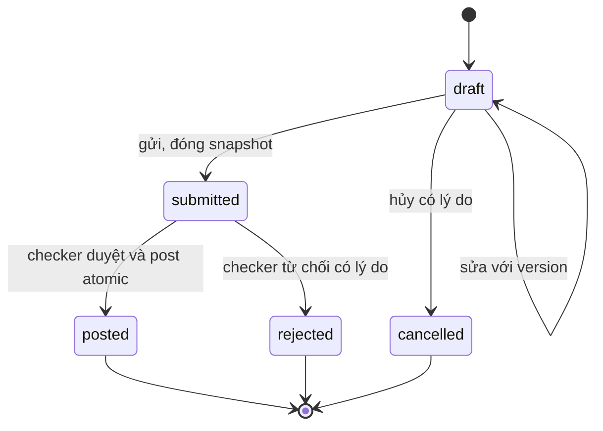
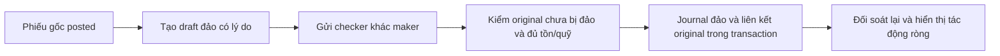
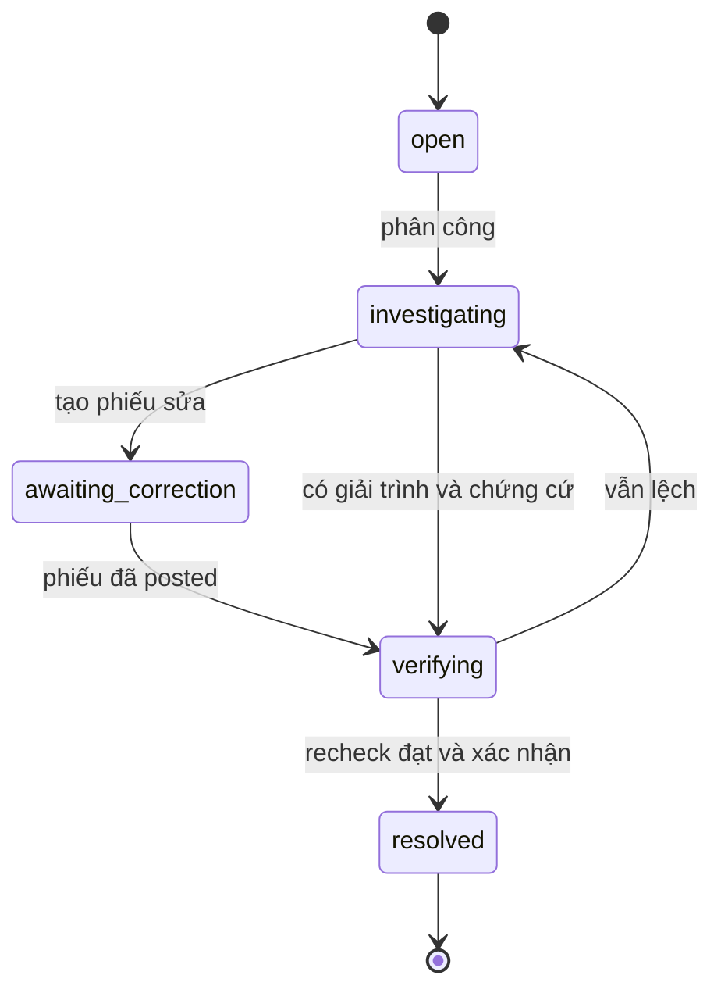

# 03 — Nghiệp vụ và trải nghiệm nhân viên

Trạng thái: **thiết kế đề xuất**, không phải mô tả tất cả tính năng đã triển khai. Phạm vi sản phẩm là vận hành kho, tài sản và **quỹ mô phỏng** nội bộ.

## 1. Người dùng và một ngày làm việc

| Người dùng | Mục tiêu | Màn bắt đầu | Kết quả cuối ngày |
|---|---|---|---|
| Nhân viên tạo phiếu | Cấp phát/nhận vật tư; thu/chi mô phỏng; theo dõi đề nghị | Việc của tôi | Không còn phiếu không rõ trạng thái; việc dở dang có người tiếp nhận |
| Kiểm soát viên | Xem chứng từ, quyền, tác động và quyết định | Chờ tôi duyệt | Mỗi quyết định có lý do/chứng cứ; không tự duyệt |
| Thủ kho/quản lý tài sản | Kiểm kê, serial, vị trí và người giữ | Kho và tài sản | Sổ kho, kiểm đếm và trách nhiệm được đối chiếu |
| Nhân viên quỹ | Quản lý két, mệnh giá và bàn giao ca mô phỏng | Ca của tôi | Số đếm và số sổ có biên bản, sai lệch được chuyển xử lý |
| Trưởng đơn vị | Theo dõi backlog, quá hạn, phân công, ngoại lệ | Tổng quan đơn vị | Việc quá hạn/sai lệch có owner; không có quyền sửa ledger trực tiếp |
| Kiểm toán | Truy vết phiếu → quyết định → sổ → chứng từ | Tra cứu và báo cáo | Xuất snapshot đúng phạm vi, có audit |
| Quản trị tích hợp | Chuẩn bị nguồn và staging; xử lý lỗi | Tích hợp | Import có nguồn, mapping và draft rõ ràng |
| Quản trị hệ thống | Cấp/thu hồi tài khoản, role và scope | Quản trị | Quyền đúng người/đơn vị; thao tác quản trị có audit |

Một người có thể nhiều vai trò nhưng không duyệt phiếu mình tạo. Quản trị hệ thống không mặc nhiên được duyệt giao dịch.

## 2. Ma trận quyền đích

Ký hiệu: **M** = của mình; **P** = trong phạm vi được cấp; **Đ** = quyền được cấp bổ sung rõ ràng; **—** = không có mặc định. Mọi quyền phải kiểm tại API, kể cả truy cập URL trực tiếp.

| Hành động | Maker | Checker | Thủ kho | Quỹ | Trưởng đơn vị | Auditor | Integration admin | System admin |
|---|---|---|---|---|---|---|---|---|
| Xem tồn/số dư | P | P | P kho | P quỹ | P | P | Đ | — |
| Tạo/sửa/hủy draft | M | Đ | M kho | M quỹ | Đ | — | Đ | — |
| Submit draft | M | Đ | M kho | M quỹ | Đ | — | Đ | — |
| Approve/reject | — | P, khác maker | Đ | Đ | Đ | — | — | — |
| Quản lý danh mục | — | — | P kho | Đ két | Đ | — | — | — |
| Kiểm kê/bàn giao | Đ | Xem/duyệt P | P | P | P | Xem P | — | — |
| Chạy đối soát | — | Đ | P kho | P quỹ | P | — | — | — |
| Xử lý exception | — | Duyệt phiếu sửa | P kho | P quỹ | Phân công P | Chỉ xem | — | — |
| Import dữ liệu | Đ | — | Đ | — | — | — | P | — |
| Quản trị connector/secret ref | — | — | — | — | — | — | P | Đ |
| Báo cáo/export | P có cấp | P có cấp | P kho | P quỹ | P | P | Run được cấp | Audit quản trị |
| Cấp tài khoản/quyền | — | — | — | — | Đ phê duyệt | — | — | P |

Phân tách `integration:import` khỏi `integration:manage`; một nhân viên nhập CSV không cần được sửa connector. Phân tách `reconciliation:read/run/resolve`; auditor chỉ đọc. `allowed_actions` từ server giúp UI hiển thị đúng, nhưng command vẫn kiểm quyền lại.

## 3. Kiến trúc thông tin và màn hình

Desktop: sidebar, danh sách + detail panel, filter giữ trên URL. Mobile: “Việc”, “Phiếu”, “Kho/Quỹ”, “Thêm”; checker ưu tiên “Duyệt”. Phân vai bằng capabilities, không chỉ tên role.

| Màn | Thông tin bắt buộc | Hành động chính |
|---|---|---|
| Việc của tôi | Nháp chưa gửi, chờ tôi duyệt, bị từ chối, sắp/quá hạn, ca đang mở; chỉ phạm vi được cấp | Tiếp tục việc, tạo phiếu, mở detail |
| Danh sách phiếu | Mã, loại, đơn vị/kho/két, tác động, maker, status, ngày nghiệp vụ, thời gian gửi, version | Lọc server, mở, copy link, tạo từ phiếu bị từ chối |
| Detail phiếu | Lines/bảng kê, lý do maker, chứng từ, maker/checker, phiên bản, kết quả posting, timeline | Chỉ action hợp lệ: sửa/gửi/hủy/duyệt/từ chối/tạo đảo |
| Hộp thư duyệt | Scope, tuổi phiếu, tác động, cờ thiếu chứng từ, policy step-up | Xem detail trước quyết định; kết quả bulk từng phiếu |
| Kho | Tồn theo location/SKU, serial, mức cảnh báo, lần cập nhật | Nhập/xuất/chuyển, xem movement, kiểm kê |
| Tài sản | Serial, tình trạng, người giữ, location, history | Cấp phát/thu hồi/điều chuyển có biên bản |
| Quỹ mô phỏng | Cashbox, số dư sổ, ca, số kiểm đếm, pending tác động chưa ghi sổ | Thu/chi, bảng kê, bàn giao |
| Đối soát | Scope/cutoff, kết quả, expected/actual/delta, owner, trạng thái xử lý | Điều tra, gắn phiếu sửa, chạy lại, đóng |
| Tích hợp | Connector được cấp, mapping, preview toàn bộ, lỗi theo dòng, run | Tải file, sửa nguồn, xác nhận tạo draft |
| Báo cáo | Phạm vi, business date, snapshot/as-of, chỉ tiêu và đơn vị | Xem, export được cấp; không sửa số |
| Hoạt động | Việc liên quan người dùng, timestamp, liên kết resource, read/unread | Mở đúng đối tượng, retry chỉ khi hợp lệ |
| Cá nhân/quản trị | Profile, session, quyền hiệu lực; quản trị tách màn riêng | Đổi thông tin cá nhân; quyền/scope chỉ admin |

Mọi màn có loading/empty/error/forbidden/stale/offline rõ ràng. Màu đi kèm nhãn trạng thái. Nút disabled có lý do. Giao dịch mô phỏng luôn có nhãn dễ thấy, kể cả PDF/Excel. Không đưa tên class, provider AI hay mã SQL vào thông điệp thao tác thông thường.

Wireframe chức năng desktop:

```text
BankOps   [Đơn vị đang làm việc]    [Tìm phiếu...]     [Thông báo] [Tài khoản]
Việc      Việc của tôi                       [Tạo phiếu]
Phiếu     [Nháp 3] [Chờ tôi xử lý 5] [Quá hạn 1] [Sai lệch 2]
Duyệt     Bộ lọc: loại / kho-két / trạng thái / ngày
Kho       Mã | Loại | Tác động | Trạng thái | Người liên quan | Hạn
Quỹ       ---------------------------------------------------------
Đối soát  Chọn một dòng → panel chi tiết + chứng từ + timeline
Báo cáo   Hành động phù hợp quyền ở cuối panel; không bị che trên mobile
```

## 4. State machine phiếu



Đề xuất pilot không cho chỉnh/sửa nội dung submitted. Rejected là final; “Tạo lại” clone sang draft mới có `copied_from`, giữ lịch sử cũ. Muốn “trả bổ sung” cần thiết kế revision và invalidation chữ ký riêng ở giai đoạn sau. Cancel draft có audit; không delete cứng.

Phiếu posted không đổi trạng thái ngược về draft. Đảo/điều chỉnh là phiếu mới có liên kết; màn detail gốc hiển thị quan hệ để nhân viên hiểu tác động ròng.

## 5. Luồng nghiệp vụ chi tiết

### W01 — Vào ca và xác định phạm vi

1. Nhân viên đăng nhập bằng tài khoản được cấp; hệ thống tải capabilities và scope.
2. Nếu có nhiều đơn vị, chọn đơn vị trong danh sách được cấp. Nếu chưa có scope, màn “Chưa được phân công” có hướng dẫn liên hệ quản trị, không tự gán demo branch.
3. Mở “Việc của tôi”; kiểm tra phiên, ngày nghiệp vụ, dữ liệu đã đồng bộ và ca phụ trách.
4. Với quỹ, mở ca/két được phân công; nhận số mở đầu từ sổ và biên bản bàn giao trước.

Khóa user/thu hồi scope phải chặn command đang thao tác sau khi server kiểm lại; không chỉ ẩn menu ở lần login sau.

### W02 — Nhập/xuất vật tư

| Bước | Nhân viên | Hệ thống |
|---|---|---|
| Lập | Chọn nhập/xuất, location, nhiều SKU, số lượng, lý do, chứng từ | Kiểm item/location active, đơn vị tính, số lượng và scope |
| Lưu | Lưu nháp, tiếp tục sau | Không đổi tồn; trả ID/version, chỉ báo lưu khi server xác nhận |
| Gửi | Xem tổng hợp và bấm gửi | Validate toàn phiếu; khóa nội dung snapshot; ghi audit/outbox |
| Kiểm soát | Checker xem chi tiết/chứng từ và tồn hiện tại | Loại maker khỏi quyền quyết định phiếu này; áp policy |
| Ghi sổ | Checker duyệt | Lock tồn, kiểm đủ, tạo movement/balance/decision atomic |
| Hoàn tất | Maker nhận trạng thái và biên nhận | Timeline ghi người, thời gian, liên kết movement |

Số tồn lúc lập chỉ là tham khảo, không phải giữ chỗ. Tồn khả dụng được kiểm lại khi duyệt. Nếu không đủ: giữ submitted, trả `INSUFFICIENT_STOCK`, hiển thị tồn mới; checker có thể từ chối. Pilot chưa có reservation.

### W03 — Chuyển kho

Chọn nguồn và đích khác nhau; maker cần phạm vi hợp lệ cho luồng chuyển. Trong pilot, chuyển nội bộ cùng đơn vị, một lượt duyệt tạo hai movement `-qty/+qty` trong một transaction. Tổng lượng toàn phạm vi không đổi.

Chuyển liên chi nhánh/vận chuyển thực tế cần “xuất đi → đang vận chuyển → nhận đến”, chứng từ và người nhận. Đây là **mở rộng P2**, không dùng transaction chuyển tức thì để mô tả hàng đang vận chuyển.

### W04 — Tài sản/ấn chỉ theo serial

Đăng ký → có sẵn → đề nghị cấp phát → duyệt → đang được giao → đề nghị thu hồi/điều chuyển → duyệt → có sẵn hoặc người giữ mới. Serial, location và assignee có history; khi mất/hỏng tạo incident và đề nghị xử lý có duyệt.

Không cho một serial đồng thời ở hai nơi/người giữ. quantity = 1 cho từng serial; serial của phiếu xuất phải thực sự thuộc nguồn. Không sửa location trực tiếp để “điều chuyển” mà bỏ qua movement/custody event.

### W05 — Thu/chi quỹ mô phỏng

1. Chọn cashbox, receipt/payment, business date, số tiền và diễn giải.
2. Nhập bảng kê mệnh giá nếu policy yêu cầu: `denomination × count`, count nguyên không âm. Server so tổng với amount; đổi amount phải xác nhận/cập nhật bảng kê.
3. Lưu draft; đính kèm chứng từ mô phỏng, xem lại rồi gửi.
4. Checker xem số tiền, bảng kê, lý do, nguồn/đích quỹ, người lập, phiên bản và tác động dự kiến. Policy yêu cầu xác thực tăng cường thì nhập PIN của checker hoặc cơ chế được tổ chức chọn.
5. Server duyệt + journal cân + balance + decision + audit/outbox cùng transaction. Payment không làm âm két.
6. Màn thành công có request ID, journal ID, số tiền, người duyệt, thời điểm. Chứng từ xuất lấy dữ liệu canonical đã ghi sổ.

Bảng kê hiện tại trong UI chưa đáp ứng lưu/kiểm chứng server; đây là yêu cầu bổ sung. Ngưỡng high-risk phải cấu hình theo policy đã duyệt, không cho AI giảm điều kiện xác thực.

### W06 — Duyệt/từ chối và duyệt hàng loạt

Trước quyết định hiển thị snapshot đầy đủ. Duyệt luôn có confirmation nêu tác động; từ chối bắt buộc lý do riêng, giữ nguyên lý do maker. AI panel là tư vấn, không thay checklist hay quyết định người có quyền.

Bulk là nhiều command độc lập: kết quả từng phiếu `posted/conflict/forbidden/insufficient/error`, không báo “cả lô thành công” nếu có lỗi. Hiển thị nội dung của tập chọn; pilot chỉ bulk phiếu rủi ro thấp và cùng phạm vi, phiếu cần step-up xem riêng. Không chọn lại những phiếu đã posted khi retry.

### W07 — Đảo và điều chỉnh



Điều chỉnh chênh lệch cần nguồn chứng cứ: stocktake hoặc reconciliation exception. Không có ô “sửa số dư” cho nhân viên/admin. Chiều adjustment phải explicit tăng/giảm; không suy luận mọi cash adjustment là payment hoặc mọi inventory adjustment là receipt.

### W08 — Nhập CSV/JSON/Sheets

Chọn connector/scope → upload/fetch → mapping version → validate/stage → preview có lỗi từng dòng → sửa nguồn hoặc hủy → xác nhận → draft nhập kho → gửi duyệt bình thường.

Pilot giữ **all-valid confirmation**: còn dòng lỗi thì chưa confirm. Có thể stage cả dòng sai để sửa nguồn; không tự bỏ lỗi. Chạy lại nguồn giống nhau trả run cũ cùng trạng thái/preview đủ; confirm lặp không sinh draft mới. Confirm cần lock run và revalidate danh mục vì item/location có thể đã bị khóa sau preview.

Một nhân viên có quyền nhập phải có quyền tạo/submit các draft trong scope tương ứng; không tạo draft mà chính người đó không thể xử lý tiếp. Connector lỗi → failed/retryable, không tạo dữ liệu mẫu để báo thành công.

XLSX và nhập phiếu quỹ là phần mở rộng riêng; không hiển thị là đã hỗ trợ khi chỉ có CSV/JSON nhập kho.

### W09 — Kiểm kê và xử lý sai lệch

1. Chọn kho/cutoff; chụp expected từ movement và baseline đã xác nhận.
2. Nhân viên nhập counted theo SKU/serial, có người đếm/thời gian. Pilot khóa giao dịch kho trong phiên kiểm kê hoặc chọn quy tắc cutoff rõ ràng; không trộn hai cách.
3. Server tính delta; khớp thì gửi xác nhận; lệch thì tạo exception có owner.
4. Người xử lý điều tra; nếu cần điều chỉnh thì tạo draft adjustment liên kết exception.
5. Checker khác maker duyệt adjustment; chạy lại đối soát và đóng exception khi phép so đạt.



Cash reconciliation phải so cả cân journal **và** tổng entry từng cashbox với read model; inventory so hợp keys của movement/balance, kể cả balance có mà không movement. Kiểm đếm thực tế là lớp đối chiếu thứ ba, khác phép đối soát hai bảng dữ liệu.

### W10 — Bàn giao và cuối ngày

Ca mở → yêu cầu bàn giao → chốt cutoff → kiểm đếm mệnh giá → so số sổ → bên nhận xác nhận → checker phê duyệt khi policy yêu cầu → đóng ca và mở ca nhận.

Pilot không chuyển tiền giữa cashbox chỉ vì bàn giao người giữ. Nếu thực sự điều chuyển tiền, dùng transaction riêng đã duyệt. Số cuối ca là snapshot có nguồn sổ, không ghi đè balance bằng con số kiểm đếm.

Không đóng ca nếu còn command chưa xác định kết quả hoặc sai lệch chưa xử lý. Phiếu submitted chưa post phải được liệt kê và chuyển trách nhiệm; không tự duyệt để “chốt ngày”. Mở lại ngày/ca cần quyền, lý do và audit riêng; chính sách này phải được đơn vị xác nhận trước xây dựng.

### W11 — Báo cáo/kiểm toán

Chọn đơn vị, kho/két, business date, chỉ tiêu → query theo scope → export snapshot có `as_of`, bộ lọc, người xuất, watermark mô phỏng. Export không lấy dữ liệu giả fallback hay chỉ trang đang hiển thị. Drill-down từ tổng → journal/movement → request → approval → attachment.

Báo cáo tách rõ số phiếu tạo, số phiếu posted, lượng movement, tồn cuối kỳ. Transfer nội bộ không được hiểu là nhập mới toàn hệ thống. Business date theo múi giờ đơn vị; lưu timestamp UTC, không mặc định hôm nay khi thiếu dữ liệu.

## 6. Ngoại lệ và cách ứng xử UI

| Tình huống | Server | Giao diện |
|---|---|---|
| Double click/retry cùng thao tác | Replay cùng command, không ghi thêm | Khóa nút khi gửi; giữ key đến khi biết kết quả |
| Mạng mất sau khi duyệt | Trạng thái có thể đã commit | “Đang xác minh”; đọc lại request/command, không tạo key mới |
| Hai checker cùng duyệt | Một kết quả final; bên còn lại conflict hoặc replay đúng key | Tải lại và hiện ai đã xử lý |
| Hai phiếu chi cùng két | Serialize balance, chỉ lệnh đủ tiền post | Lệnh còn lại báo số dư mới; không thành công giả |
| Phiếu version cũ | 409 và version hiện tại | Giữ phần nhập, yêu cầu xem lại snapshot trước duyệt |
| Thiếu tồn/quỹ | Không ghi ledger/balance dở dang | Nêu thiếu bao nhiêu trong scope được xem |
| Phiếu/danh mục ngoài scope | 403 hoặc 404 theo policy thống nhất | Thông báo quyền, không lộ detail |
| AI chậm/lỗi | Policy vẫn độc lập | Nhãn tư vấn chưa có; cho xem xét theo policy |
| PIN sai/khóa | Rate limit theo checker bền | Không xóa phiếu; báo thời điểm thử lại, không log PIN |
| Import trùng | Run/draft cũ có provenance | Mở kết quả cũ, không thông báo tạo mới |
| SSE ngắt | REST còn authoritative | Báo dữ liệu có thể cũ, reconnect/poll có backoff |
| Một tab không có quyền | Không gọi hoặc trả forbidden riêng | Các tab còn lại dùng bình thường |
| Profile lưu lỗi | Không thay trạng thái canonical | Hiện chưa lưu và cho thử lại; không báo thành công local |

## 7. Giả định cần đơn vị nghiệp vụ xác nhận

Thiết kế tiếp tục với mặc định dưới đây; không coi là quy định vận hành chính thức.

| Chủ đề | Giả định pilot | Quyết định cần chốt |
|---|---|---|
| Tổ chức | Một đơn vị, nhiều kho/két, dữ liệu giả | Phạm vi chi nhánh/phòng giao dịch và quyền liên đơn vị |
| Ngày nghiệp vụ | Asia/Ho_Chi_Minh; ngày đóng có khóa | Giờ cutoff, cuối tuần, quyền mở lại |
| Phê duyệt | Một checker khác maker | Hạn mức, escalation, ủy quyền, có cần hai checker không |
| PIN/MFA | PIN cá nhân là bước tạm cho demo | IdP/MFA và thời hạn xác thực tăng cường |
| SLA | Hiện tuổi phiếu, chưa tự áp hạn cứng | Thời hạn theo loại/đơn vị, người nhận escalation |
| Kiểm kê | Khóa thao tác trên phạm vi kiểm kê pilot | Kiểm kê cuốn chiếu hay snapshot + biến động |
| Bàn giao | Người giao khác người nhận; lệch chưa giải quyết chặn đóng | Ai duyệt, dung sai, trường hợp vắng mặt |
| Chứng từ | Dữ liệu/chứng từ giả, private access | Loại file, dung lượng, retention, quy trình xóa |
| Nền tảng | Web desktop trước, mobile cùng nghiệp vụ | Thiết bị thật, MDM, hỗ trợ offline đọc |
| Dữ liệu thật | Ngoài phạm vi | Dự án riêng về quy trình, bảo mật và phê duyệt tổ chức |
