# 04 — Backlog triển khai và tiêu chí nghiệm thu

Trạng thái: **kế hoạch đề xuất**, chưa phải danh sách tính năng đã sửa. Không lấy số lượng test cũ trong README làm cổng chất lượng cho working tree này.

## 1. Thứ tự thực hiện

```mermaid
flowchart LR
  A[E00 Baseline và DB test riêng] --> B[E01 Danh tính và secret]
  B --> C[E02 Quyền và scope]
  C --> D[E03 Posting atomic và idempotency]
  D --> E[E04 Đảo / opening / đối soát]
  E --> F[E05 Một backend chuẩn]
  F --> G[E06 Contract và trải nghiệm phiếu]
  G --> H[E07 Events và jobs]
  H --> I[E08 Import]
  I --> J[E09 Tài sản và kiểm kê]
  J --> K[E10 Ca và bàn giao]
  K --> L[E11 Báo cáo / chứng từ / pilot]
```



Một bước có thể gồm vài PR nhỏ; không gộp migration, thay backend và làm lại UI trong một PR. P0/P1 thể hiện tác động trước pilot, không phải thứ tự dòng duy nhất. Ví dụ PIN cá nhân cần sửa trước nghiệm thu luồng duyệt dù nằm cùng hợp đồng UI.

## 2. Công việc có thể giao triển khai

### E00 — Chốt baseline khảo sát và môi trường kiểm thử (P0)

- Ghi commit/working-tree diff, xác định phần thay đổi đang làm dở; không reset/revert các thay đổi đó.
- PostgreSQL riêng cho test; chặn suite mutating trỏ vào DB nhân viên. Seed chỉ explicit demo/test.
- Tạo route/DTO inventory từ FastAPI và Worker; contract tests không chỉ check tên endpoint có tồn tại.
- Phạm vi: `backend/tests/conftest.py`, CI, Makefile, migration checks.
- Nghiệm thu: chạy từ database trống và bản schema trước; chứng minh test cô lập, không đổi mật khẩu/profile/số dư của dữ liệu đang dùng.

### E01 — Đóng các đường đăng nhập demo và secret (P0, F01–F03,F14)

- Một Google handler; mock chỉ dependency test, không dùng tiền tố token làm bypass runtime.
- Ngoài demo không trả OTP; OTP hash/TTL/attempt limit, response chống lộ tồn tại tài khoản; reset/password change thu hồi session theo policy.
- Kiểm user status trên mọi xác thực access; session/refresh rotation bền, token ID duy nhất, concurrent refresh có test.
- Bỏ SMTP secret fallback literal. Theo dõi thay/revoke credential thực với chủ sở hữu; sửa file không chứng minh credential đã bị thu hồi.
- Phạm vi: `backend/app/api/routes/auth*.py`, `services/email_service.py`, IAM model/migration, Worker auth, Compose.
- Nghiệm thu: public route trong cấu hình ngoài demo từ chối mock; response/log không OTP/PIN/token; locked user có token cũ bị chặn; refresh replay bị chặn qua restart/replica.

### E02 — Quyền theo capability và phạm vi (P0, F04–F06)

- Tách quyền đọc/quản trị danh mục, đọc/chạy đối soát, import/quản trị connector.
- Chặn sửa/xóa/submit draft không thuộc mình; auditor chỉ đọc; admin không miễn maker-checker.
- Thiết kế branch/location/cashbox grants và backfill từ danh sách xác nhận; scope kiểm cả list, detail, export, stream.
- Phạm vi: `auth_utils.py`, inventory/cash/activity/approvals/reports routes, seed, IAM migration; Flutter AppUser/RoleVisibility.
- Nghiệm thu: bảng test mọi role × action; thử ID ngoài scope; stream không phát event trái quyền; tài khoản profile sửa tên branch không đổi scope.

### E03 — Command service, atomic posting, chống trùng (P0, F08–F10,F16)

- Tách create/submit/approve/reject khỏi route sang service theo module.
- Persistent scoped idempotency, bắt buộc version với command hiện hữu; replay đúng body/status.
- Lock balance ổn định và kiểm số dư sau lock; validate Decimal/kind/location/lines/serial trước ghi.
- Unique final decision, journal/request, movement keys; error mapping cho stale/constraint rõ ràng.
- Phạm vi: `api/routes/inventory.py`, `cash_sim.py`, `services/idempotency.py`, modules mới, migrations và acceptance tests.
- Nghiệm thu: hai checker cùng phiếu; hai phiếu khác nhau cùng balance; retry qua restart; key dùng lại khác actor/route/payload; lỗi chèn audit/outbox rollback cả posting.

### E04 — Reversal, opening và reconciliation đúng nguồn (P0, F07,F11,F12,F17)

- Reverse endpoint tạo draft mới, checker khác maker; unique original reversal, lưu before/after đúng.
- Gỡ reset balance khi init; opening journal/movement có provenance sau kiểm kê dữ liệu cũ.
- Cash reconciliation kiểm cả journal cân và tổng account với balance; kho so hợp keys; Decimal, cutoff nhất quán.
- Exception có owner/status/resolution link/recheck; không tự vá hoặc trả matched khi lỗi.
- Phạm vi: cash/inventory/reconciliation models/routes/services, `database.py`, `seed.py`, migrations.
- Nghiệm thu: lệch read model dù journal cân vẫn phát hiện; balance mồ côi được phát hiện; reversal lặp chỉ post một lần; restart giữ nguyên ledger và balance.

### E05 — Chọn một tuyến backend nghiệp vụ (P0, F10,F12,F23)

- Theo ADR A01, chuyển Worker sang forward tới API chuẩn hoặc cấu hình Flutter gọi API chuẩn; giữ AI adapter riêng nếu cần.
- Trước cutover lập parity matrix URL/method/status/DTO/auth/CORS/SSE/header behavior; kiểm health/readiness upstream.
- Không fallback sang implementation SQL/placeholder khi upstream lỗi. Trả dependency failure rõ ràng.
- Phạm vi: `infra/cloudflare-worker/src/`, deploy config, API base URL và contract tests.
- Nghiệm thu: cùng một kịch bản có kết quả nghiệp vụ giống qua direct API và gateway; mất upstream không tạo fake row/matched/connected. Có rollback route/config, không rollback ledger đã post.

### E06 — Hợp đồng Flutter và luồng phiếu (P1, F13,F18–F22,F26,F27)

- AppUser giữ capabilities/scopes; sửa DTO field mismatch, enum unknown, business time, structured domain/kind.
- Header version và idempotency key theo intent; auth refresh single-flight; timeout/unknown result không báo thành công.
- Server lấy request canonical để assess AI; call PIN truyền checker user; sau đổi PIN kiểm endpoint duyệt thật.
- Form nhiều dòng, source/dest riêng, draft edit/cancel, bảng kê structured, reason bắt buộc; không default amount khi trống.
- Detail/deep link/timeline, confirmation trước duyệt, phân trang list và KPI aggregate; báo cáo tách tab theo quyền.
- Phạm vi: `frontend/lib/src/data/`, `features/requests/`, `approvals/`, `auth/`, `reports/`, `app_shell.dart`, backend DTOs.
- Nghiệm thu: widget + HTTP contract cho DTO thật; maker mở reports không bị tab reconciliation gây lỗi chung; refresh browser vào đúng phiếu; offline profile không báo lưu thành công.

### E07 — Jobs, event và thông báo có thể phục hồi (P1, F04,F15,F21)

- Job handler registry thực; lease/heartbeat/retry/backoff/dead-letter; claim an toàn cho nhiều worker.
- Outbox → durable activity/notification; chỉ mark published sau delivery bền, dedupe consumer.
- SSE xác thực theo scope, cursor/id ổn định; không token URL; heartbeat không gọi lại AI.
- Phạm vi: worker, activity/approval_events, models/migrations, repository SSE parser.
- Nghiệm thu: kill worker giữa xử lý, lease hết được chạy lại đúng; mất SSE/reconnect không mất việc; duplicate event không duplicate notification/posting.

### E08 — Hoàn thiện staging/import (P1, F23–F25)

- Connector adapter thật hoặc trạng thái unsupported; testConnection đúng headers và thực sự kiểm kết nối.
- Staging batch transaction, byte/row/format/finite number limits cho mọi nguồn, row index bền.
- Dedupe unique theo scope/source/mapping; run confirm lock, revalidate và lưu draft links.
- UI pagination staging, lỗi từng dòng, tải báo cáo lỗi an toàn; chỉ CSV/JSON/Sheets trong pilot.
- Phạm vi: integrations routes/services/models, worker handlers, ImportScreen, HTTP repository.
- Nghiệm thu: crash giữa stage không trả staged hoàn chỉnh; concurrent confirm tạo cùng một tập draft; nguồn trùng trả đủ preview; API không đòi key bí mật từ client.

### E09 — Tài sản và kiểm kê (P1)

- Vòng đời serial/custody, assign/return/transfer có approval và history.
- Stocktake snapshot/count/delta, exception và draft adjustment; policy khóa phạm vi hoặc cutoff đã chốt.
- Phạm vi: assets/inventory module, models/migrations, màn Kho/Tài sản/Kiểm kê.
- Nghiệm thu: một serial không đồng thời hai assignee/location; adjustment chỉ post sau checker; sau count có movement mới phải xử lý theo cutoff, không âm thầm ghi đè tồn.

### E10 — Ca và bàn giao quỹ mô phỏng (P1)

- Cashbox session theo ngày nghiệp vụ/người giữ; bảng kê, người giao/nhận, discrepancy và approval liên kết.
- Chặn đóng khi command chưa rõ kết quả/sai lệch chưa xử lý; thể hiện việc chờ chuyển ca.
- Phạm vi: cash module, schema session/handover, màn Ca của tôi và bàn giao.
- Nghiệm thu: người giao khác người nhận; hai lượt mở cùng két chỉ một ca active; bàn giao người giữ không tự phát sinh tiền; không sửa số dư theo số đếm.

### E11 — Chứng từ, báo cáo và pilot (P1)

- Attachment private, size/MIME/checksum/scan status, authorization download và retention xác nhận.
- Export snapshot đầy đủ có scope/bộ lọc/as-of, trace về transaction; chuẩn business date và định nghĩa KPI.
- Pilot web + mobile đã chọn; audit hành động và vận hành backup/restore có bằng chứng.
- Phạm vi: reporting/export service, attachment module, Flutter detail/reports, CI và runbook.
- Nghiệm thu: report khớp nguồn ledger, ngày kết thúc bao gồm đúng khoảng nghiệp vụ; export có đủ >100 dòng theo filter; không rò phạm vi qua attachment/export.

## 3. Bộ kịch bản nghiệm thu bắt buộc

| Mã | Kịch bản | Kết quả mong đợi |
|---|---|---|
| U01 | Maker tạo receipt kho, checker khác người duyệt | 1 decision final, đúng movement, balance tăng đúng |
| U02 | Maker/admin nhiều role tự duyệt | 403, không có side effect |
| U03 | Hai checker duyệt đồng thời cùng phiếu | Một posting; bên còn lại conflict/replay đúng semantics |
| U04 | Tồn 10, hai phiếu issue 7 cùng duyệt | Chỉ một phiếu post, balance 3 |
| U05 | Quỹ 100, hai payment 80 đồng thời | Chỉ một journal được post, balance 20 |
| U06 | Client timeout sau commit rồi retry cùng key | Trả kết quả cũ, không thêm ledger |
| U07 | Cùng key khác payload/operation/actor | Khác payload cùng scope 409; actor/operation khác không lấy response người khác |
| U08 | Restart/đổi replica rồi retry | Replay bền; balance không bị reset |
| U09 | Fault injection trước audit/outbox/result commit | Toàn bộ posting rollback |
| U10 | Đổi PIN cá nhân, gọi approve high-risk | PIN cũ sai, PIN mới đúng qua HTTP endpoint; khóa theo đúng checker |
| U11 | Ngoài demo gửi mock OAuth hoặc xin OTP | Không bypass identity; không trả OTP |
| U12 | Auditor ghi danh mục/xóa draft/chạy command | Bị từ chối theo ma trận quyền |
| U13 | User bị khóa có access token còn hạn | Command/read protected bị chặn theo policy |
| U14 | Truy cập phiếu/stream/export ngoài scope | Không lộ resource/event/dữ liệu |
| U15 | Đảo phiếu posted | Tạo draft trước; balance chỉ đổi sau người khác duyệt; đảo lần hai bị chặn |
| U16 | Journal cân nhưng sửa read model lệch trong DB test | Reconciliation tạo exception đúng expected/actual |
| U17 | Balance tồn tại nhưng không movement/baseline | Phát hiện sai lệch, không matched giả |
| U18 | Concurrent import confirm, nguồn lặp | Một tập draft có provenance; chưa có movement trước duyệt |
| U19 | Connector không chạy được | Failed/unavailable, không có row mẫu được báo là thật |
| U20 | Worker chết, SSE mất rồi nối lại | Job phục hồi, notification dedupe, REST cho trạng thái đúng |
| U21 | Bảng kê tổng khác amount, serial trùng | Validation field, không submit/post |
| U22 | Profile lưu lỗi, report tab 403 | Không báo lưu thành công; tab được cấp vẫn dùng được |
| U23 | List >100 records, filter qua nhiều trang | Không trùng/thiếu trang; KPI/export không đếm riêng trang đầu |
| U24 | Ca có chênh lệch hoặc command chưa rõ kết quả | Chưa được đóng; hiển thị việc cần xử lý |
| U25 | Cùng kịch bản qua gateway và API | Cùng invariant, DTO và error semantics |

Unit test kiểm phép tính/policy; PostgreSQL integration test kiểm lock/unique/rollback; HTTP test kiểm dependency/route/auth; Flutter test kiểm state/DTO; E2E hai phiên đăng nhập kiểm hành trình. Không dùng SQLite hoặc fake repository để chứng minh concurrency PostgreSQL hay API authorization.

## 4. Cổng nghiệm thu pilot

1. F01–F12 được sửa hoặc đường gây lỗi được loại khỏi tuyến triển khai và có test chứng minh. Không nghiệm thu chỉ bằng “nút bị ẩn”.
2. Một backend authoritative; P0 transaction/auth/scope có test qua public route, bao gồm concurrency khác request.
3. Luồng nhân viên được chọn cho pilot chạy end-to-end; tính năng chưa xây được ẩn hoặc báo chưa hỗ trợ rõ, không placeholder success.
4. Migration từ trống và upgrade có bằng chứng; restart không đổi dữ liệu; backup restore vào DB riêng và đối soát lại đạt.
5. Web tại 360/768/1280 px và mobile target đã chốt; keyboard, text scale, focus, lỗi mạng/401/409 được kiểm tra thực tế.
6. Có owner cho ngoại lệ, hướng dẫn hỗ trợ bằng request ID và cách dừng ghi khi phát hiện lệch. RPO/RTO và capacity chỉ công bố sau đo.
7. Nghiệp vụ xác nhận hạn mức, ngày nghiệp vụ, ca, quyền và scope; pilot vẫn chỉ dữ liệu giả/quỹ mô phỏng.

## 5. Lệnh kiểm tra và bằng chứng phiên hiện tại

Chỉ chạy các suite mutating sau khi E00 cung cấp database test riêng. `make check-all` hiện chưa bao gồm mọi cổng nghiệp vụ phía trên.

```bash
# Kiểm helper, không cần khởi động ứng dụng/DB
python3 -m pytest backend/tests/test_approval_controls.py -q

# Các bước cho môi trường test đã cô lập
make analyze-backend
make analyze-frontend
make typecheck-worker
make test-backend
make test-frontend
```

Kết quả thực tế đã chạy trong khảo sát: **7 passed** cho helper PIN. Chưa chạy toàn bộ các lệnh còn lại trong phiên này. Chưa có screenshot UI, test thiết bị, load test, live cloud test hay diễn tập restore mới. Những mục này là việc phải làm trong triển khai, không phải kết quả đã đạt.

## 6. Ngoài pilot

P2: chuyển kho liên chi nhánh có vận chuyển/nhận hàng, workflow nhiều cấp/ủy quyền theo hạn, notification push, barcode, offline read theo chính sách, XLSX import, dashboard nâng cao. Core banking và tiền thật không thuộc kế hoạch này.
