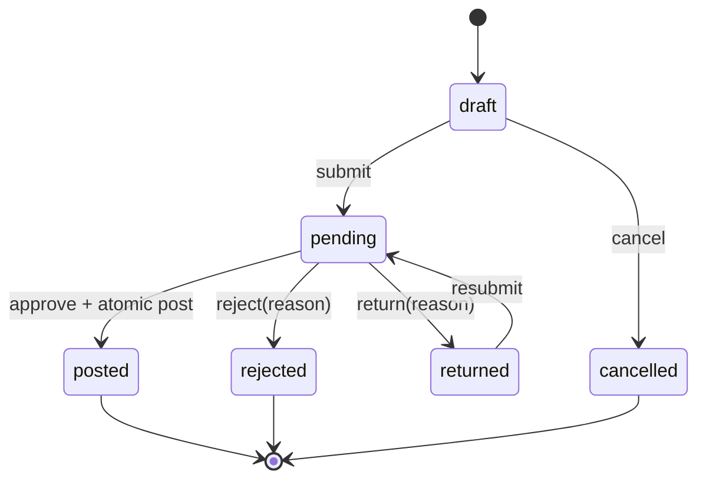

# 05 — State machine, phê duyệt, đối soát

## State machine

MVP có một checker, người khác maker. `approve` cần capability theo module, trạng thái pending, version khớp, chính sách tồn/số dư đạt. Rejected và returned phải có lý do. Không sửa posted; reversal hoặc adjustment là yêu cầu mới cần duyệt.

## Transaction chuẩn

1. Xác thực, RBAC, parse `Idempotency-Key` và `If-Match`.
2. Tìm kết quả idempotency cũ theo `(actor, route, key)`, trả đúng response cũ nếu payload hash trùng; khác payload trả 409.
3. `SELECT ... FOR UPDATE` request và balance cần dùng; kiểm tra trạng thái, version, maker/checker.
4. Ghi decision, movement/journal, balance, audit, outbox trong một DB transaction.
5. Commit rồi trả response; lỗi trước commit rollback toàn bộ.

Đặt unique constraints ở DB là lớp bảo vệ cuối cùng khi hai checker cùng bấm. API trả 409 `CONFLICT_VERSION`/`ALREADY_FINAL` nhất quán. Token idempotency giữ ít nhất 24 giờ, tài liệu retention trong config; journal unique theo request bảo vệ lâu dài.

## Đặt trước tồn kho (Reserved Inventory)

Khi Maker lập phiếu xuất kho và bấm Gửi duyệt (submit), hệ thống ngay lập tức chuyển lượng hàng này vào trạng thái Đặt trước (`reserved_quantity`), làm giảm số lượng Khả dụng (`available_quantity = quantity - reserved_quantity`). Cơ chế này đảm bảo không xảy ra tình trạng nhiều phiếu cùng tranh chấp một lượng tồn kho. Khi Kiểm soát viên duyệt thành công, tồn kho thực tế bị trừ và giải phóng lượng đặt trước. Nếu phiếu bị từ chối hoặc trả về, lượng tồn đặt trước được hoàn trả về tồn khả dụng.

## Trả về chỉnh sửa (Return for Rework)

Kiểm soát viên có thể chọn Trả về (return) kèm ý kiến KSV bắt buộc (`return_reason`). Phiếu chuyển sang trạng thái `returned`. Maker nhận thông báo, xem lý do trả về trên giao diện, thực hiện chỉnh sửa và bấm Gửi duyệt lại (`resubmit`) mà không cần phải hủy phiếu và lập mới từ đầu.

## Quản lý serial & ấn chỉ bảo mật (Asset Lifecycle & Handover)

Mỗi phôi thẻ chip EMV, sổ séc, chứng chỉ tiền gửi được định danh bằng số serial duy nhất. Trạng thái ấn chỉ tuân thủ vòng đời: trong kho (`in_vault`), đã cấp phát (`assigned`), đang sử dụng (`in_use`), hỏng (`damaged`), thất lạc (`lost`). Mọi giao dịch điều chuyển hoặc bàn giao đều ghi vào sổ nhật ký ấn chỉ (`inv_asset_logs`) với thông tin người giao, người nhận, thời điểm và ghi chú biên bản.

## Định mức an toàn tồn kho (Min/Max Safety Levels)

Mỗi mặt hàng tại từng kho đều có định mức tối thiểu (`min_level`) và tối đa (`max_level`). Khi số lượng khả dụng chạm hoặc dưới ngưỡng tối thiểu, hệ thống tự động sinh cảnh báo và gợi ý lập phiếu điều chuyển/nhập kho bổ sung.

## Quy định kiểm soát kép và hạn mức duyệt (Dual Control & Limits)

- **Nguyên tắc Maker - Checker (Ai được lập và duyệt phiếu)**: Người lập phiếu (`created_by` / Maker) và người duyệt phiếu (`approved_by` / Checker) bắt buộc phải là hai người dùng khác nhau (`created_by != approved_by`). Người tạo không thể tự duyệt phiếu của chính mình, kể cả tài khoản Quản trị viên (`admin`). Giao dịch viên (GDV / role `staff`) lập phiếu, Kiểm soát viên (KSV / role `approver`) kiểm tra và phê duyệt.
- **Quy định duyệt phiếu trên 500 triệu (≥ 500.000.000 VND)**: Giao dịch quỹ tiền mặt mô phỏng có giá trị từ 500 triệu đồng trở lên thuộc diện rủi ro cao (High Risk), bắt buộc thực hiện kiểm soát kép đặc biệt: yêu cầu xác thực mã PIN Kiểm soát viên (Supervisor PIN), hệ thống sinh mã băm Audit Stamp SHA-256 để đảm bảo tính toàn vẹn, kiểm đếm tiền mặt thực tế tại két và lập biên bản bàn giao có đủ 2 chữ ký của Maker và Checker.
- **Hạn mức ấn chỉ bảo mật**: Phiếu xuất/nhập từ 50 đơn vị ấn chỉ/phôi thẻ (thẻ chip EMV, sổ séc trắng) trở lên thuộc diện kiểm soát nghiêm ngặt, bắt buộc kiểm đếm dải số serial và niêm phong hộp phôi trước khi ký duyệt.

## Đối soát

- Hàng ngày hoặc chạy tay: so tổng movements với `inv_balances`; so tổng journal entries với `cash_balances`.
- So danh sách asset active với vị trí/serial; kiểm tra double assignment.
- Kết quả gồm `matched`, `exception` (chênh lệch/sai lệch), `running`, `failed`; exception có expected, actual, source IDs, người xử lý, thời điểm.
- Khi đối soát có chênh lệch hoặc sai lệch: Không tự động vá sai lệch. Kiểm toán nội bộ (Auditor) kiểm tra, người vận hành (Operator) tạo phiếu điều chỉnh (adjustment) hoặc đảo bút toán (reversal) có hai người duyệt (Maker-Checker). Chạy lại đối soát sau khi xử lý và lưu vết cả hai lần chạy.

## Mẫu lỗi nghiệp vụ

`INSUFFICIENT_STOCK`, `INSUFFICIENT_SIM_CASH`, `SELF_APPROVAL_FORBIDDEN`, `INVALID_STATE`, `CONFLICT_VERSION`, `IDEMPOTENCY_KEY_REUSED`, `DUPLICATE_SERIAL`, `RECONCILIATION_EXCEPTION`.
