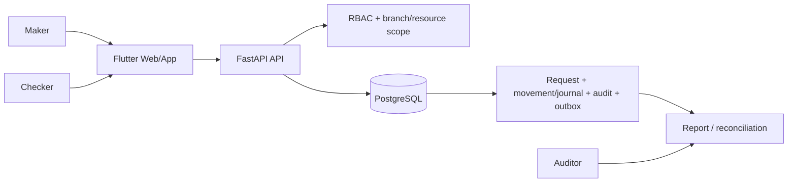

# QuanLyKho — Interview Kit

## Business brief

**Vấn đề:** một cửa hàng trà sữa cần kiểm soát tồn nguyên liệu theo kho/chi nhánh,
lô và hạn dùng; phiếu nhập/xuất và chốt ca không được làm sai lệch số lượng khi có
nhiều người thao tác. Một số module quỹ và ledger có mặt để minh hoạ financial
operations controls, nhưng không phải thanh toán thật hay core-banking.

**Người dùng:** maker lập phiếu; checker phê duyệt phiếu; auditor chỉ đọc audit và
báo cáo; quản trị viên provision user/scope. FastAPI + PostgreSQL là business
authority; Cloudflare Worker không phải write authority.



## Sequence và failure handling

```mermaid
sequenceDiagram
  participant M as Maker
  participant API as FastAPI
  participant DB as PostgreSQL
  participant C as Checker
  M->>API: Create draft (Idempotency-Key)
  API->>DB: Persist request + idempotency result
  DB-->>API: Commit once
  API-->>M: Draft/result
  M->>API: Submit
  C->>API: Approve (different actor, scope checked)
  API->>DB: Lock balances; post movement/journal, audit, outbox in one transaction
  alt conflict, insufficient stock/cash, duplicate key, forbidden scope
    DB-->>API: Roll back whole transaction
    API-->>C: Explicit 4xx conflict/denial; no partial posting
  else commit
    DB-->>API: Atomic result
    API-->>C: Posted
  end
```

## Five-minute demo

1. State the boundary: tea-shop inventory is the primary product; cash is labelled
   simulation and no real banking/payment integration exists.
2. Start the local demo profile, then authenticate as a maker and checker with
   locally provisioned demo accounts. Do not display or reuse credentials in slides.
3. Create a receipt with a lot and expiry date; show the draft and the checker
   approval as different actors.
4. Show the resulting balance/movement and audit entry. Retry the same command with
   the same idempotency key and show that it does not post twice.
5. Attempt an action outside the branch/cashbox scope and show the denial. End with
   `make test-backend`, which creates a disposable PostgreSQL database rather than
   mutating the developer database.

## Decisions and trade-offs

| Decision | Why | Trade-off / evidence |
|---|---|---|
| FastAPI is the only business write authority | One transactional model for RBAC, posting and audit | Worker parity is intentionally not claimed; see [ADR 0001](adr/0001-canonical-api-fastapi-worker-proxy-deprecation.md). |
| PostgreSQL is the source of truth | Row locks and database constraints protect stock/cash races | Requires real PostgreSQL test coverage; SQLite is not accepted as an equivalent substitute. |
| Cash is a simulation | Demonstrates maker-checker, journal and reversal without misleading claims | No payment provider, customer money, or core-banking integration. |
| Demo profile is opt-in | Allows a reproducible interview flow without weakening runtime defaults | Demo auth/Google mocks must be off outside demo. |

## Non-claims

- Not production-ready and not a core-banking system.
- No real money, bank customer data, payment processor, or banking integration.
- No UAT sign-off, live IdP proof, production tenant model, or completed DR proof.
- A passing local suite is evidence for the tested working tree only; CI must run on
  the exact commit before it is presented as CI-verified.
- AI support is advisory only and must not make inventory, approval, or posting
  decisions.
